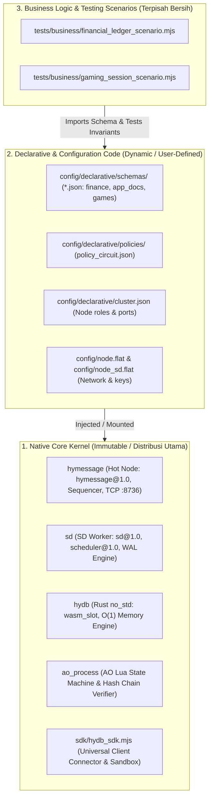
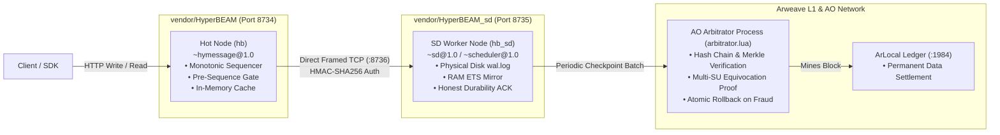

# Universal Distributed Real-Time Database & Fault-Tolerant Compute Stack (AO + HyperBEAM)

> **Sub-15ms Universal Database & Compute Stack with HyDB Core Contract (`hydb.core@1.0`), Dual Pluggable Storage Backends (`wasm_slot` & `ets_doc`), Honest Durability SD Worker Pool, and Logical Security Domain AO Arbitrator**

[](https://github.com/permaweb/HyperBEAM)
[]()
[](https://ao.g8way.io/)
[-red.svg)](https://www.rust-lang.org/)
[](https://gleam.run/)
[]()

> [!NOTE]
> **Catatan Lingkungan Pengujian (Disclaimer PoC Environment):**
> Seluruh rangkaian pengujian dijalankan dalam **lingkungan lokal 100% (Local Self-Contained Sandbox)** untuk memverifikasi ketahanan kegagalan (*fault-tolerance*), keamanan kriptografis, dan performa tanpa biaya gas/token:
> - **HyperBEAM Dual-Node Terpisah Fisik:** Berjalan di mesin lokal (`:8734` Hot Node via `vendor/HyperBEAM`, `:8735` SD Node via `vendor/HyperBEAM_sd`).
> - **Ledger Arweave:** Menggunakan simulator lokal **ArLocal** (`:1984`) sehingga pencatatan blok dan transaksi tidak memerlukan biaya token $AR sesungguhnya.
> - **AO Process Arbitrator:** Menggunakan engine WebAssembly resmi **`@permaweb/ao-loader`** yang mengeksekusi binary proses resmi AO (`process.wasm`) dan skrip Arbitrator Lua (`arbitrator.lua`) + verifier domain keamanan (`real_ao_evaluator.mjs`).

---

## 1. Pemisahan Tiga Lapisan Arsitektur (Architecture Segregation)

Untuk menjaga stabilitas jangka panjang dan kemudahan distribusi, sistem ini memisahkan secara ketat tiga domain kode:



1. **Native Core Kernel (Immutable)**: Kode inti protokol yang didistribusikan ke publik/operator. Tidak pernah diubah untuk keperluan use-case bisnis tertentu.
2. **Declarative & Configuration Code (Dynamic)**: Skema data JSON, pemetaan sanksi *Policy Circuit*, dan topologi cluster. Pengguna bebas menambah atau mengubah konfigurasi ini tanpa *recompile* kernel native.
3. **Business Logic Scenarios (Isolated)**: Logika pengujian aplikasi bisnis (finansial, game session) yang terisolasi total dari direktori runtime.

---

## 2. Topologi Jaringan & Dual HyperBEAM Runtime

Dalam direktori `vendor/`, contoh ini terdapat **dua instalasi HyperBEAM fisik independen** untuk mencegah polusi dependensi (*zero cross-contamination*):



| Node | Direktori Vendor | Port HTTP / TCP | Device Terpasang | Peran Khusus |
| :--- | :--- | :--- | :--- | :--- |
| **Hot Node** | `vendor/HyperBEAM` | `:8734` / `:8736` | `~hymessage@1.0` | Primary Sequencer, CAS lock, Pre-Sequence Gate, TCP Stream Server. |
| **SD Node** | `vendor/HyperBEAM_sd` | `:8735` | `~sd@1.0`  | Shared Data Pool, verifikasi tanda tangan batch, append deterministik `sd/wal.log`, honest durability ACK. |
| **AO Arbitrator** | `ao_process/` | Process AO | `HYDB_ARBITRATOR` | Wasit L1/L2 Arweave, verifikasi independen rantai hash, pembuktian kecurangan (*equivocation proof*). |
| **ArLocal** | `.arlocal-db/` | `:1984` | Gateway Arweave | Penyimpanan permanen block ledger. |

---

## 3. Dua Backend Penyimpanan: `wasm_slot` vs `ets_doc`

Stack ini mendukung dua backend penyimpanan di bawah satu protokol pengurutan kanonikal:

| Fitur | `wasm_slot` (Rust WebAssembly) | `ets_doc` (BEAM Concurrent Table) |
| :--- | :--- | :--- |
| **Mesin** | Rust `no_std` ([`hydb/src/lib.rs`](hydb/src/lib.rs)) | Erlang Term Storage (ETS) |
| **Tipe Key / Val** | Wajib numerik `int64` / `int64` | String fleksibel / `json`, `string`, `bytes` |
| **Karakteristik** | $O(1)$ Slot Array, Zero-GC, sub-milidetik | Fleksibel, mendukung nested JSON |
| **Batas Aturan** | Ditegakkan langsung di level instruksi WASM (`-422`) | Ditegakkan via parser skema Erlang |
| **Fitur Ekstensi** | `fast_fingerprint_64`, `snapshot` binary RAM | `structured_doc`, `prefix_scan` (`GET /scan`) |
| **Peruntukan Ideal** | Saldo finansial, counter token, state game real-time | Profil pengguna, metadata NFT, katalog dokumen |

---

## 4. Tiga Guardrail Keamanan Konstitusional

1. **Guardrail A — Pre-Sequence Contract Gate:**
   Validasi skema, tipe data, kapabilitas backend, dan versi CAS (`expected_ver`) dilakukan **SEBELUM** Hot Node mengalokasikan nomor urut `Seq`. Request yang cacat (`400`/`409`/`422`/`501`) ditolak secara bersih tanpa menaikkan nomor `Seq` dan tanpa mencemari WAL.
2. **Guardrail B — Independent Arbitrator Schema & Commitment Verification:**
   Arbitrator AO tidak percaya buta pada klaim Hot Node maupun SD Node. Arbitrator mengunduh kontrak langsung dari Arweave (*Zero-Trust Autonomous Pull*), memvalidasi ulang rantai hash SHA-256, serta menghitung ulang **64-bit Fast Fingerprint (Merkle-XOR)** dan **256-bit Cryptographic State Commitment (Canonical SHA-256)** di dalam *Atomic Staging Area*.
3. **Guardrail C — Batas Konstitusional Policy Circuit:**
   Arbitrator menentukan **fakta kriptografis (Verdict)**; `PolicyCircuit` milik developer menentukan tindakan operasional. Jika konfigurasi `PolicyCircuit` mencoba memaksa menerima batch yang tidak sah (`FORCE_ACCEPT`), guardrail otomatis memblokir override tersebut (`policy_guardrail_enforced: true`) dan menjaga state resmi tetap utuh.

---

## 5. Matriks Pengujian & Verifikasi Lengkap

Stack ini telah lulus audit ketat dan diverifikasi 100% pada semua rangkaian tes:

| Rangkaian Uji | Berkas Pengujian | Hasil Verifikasi |
| :--- | :--- | :---: |
| **Cross-Language Conformance** | [`tests/contract_conformance.mjs`](tests/contract_conformance.mjs) | **63 / 63 PASSED** |
| **Contract Enforcement & Gating** | [`tests/test_tahap3_enforcement.mjs`](tests/test_tahap3_enforcement.mjs) | **34 / 34 PASSED** |
| **Schema & Capability Rules** | [`tests/test_tahap4_schema.mjs`](tests/test_tahap4_schema.mjs) | **38 / 38 PASSED** |
| **Physical Durability & WAL** | [`tests/test_tahap5_durability.mjs`](tests/test_tahap5_durability.mjs) | **39 / 39 PASSED** |
| **AO Arbitrator State Machine** | [`tests/test_tahap6_ao_arbitrator.mjs`](tests/test_tahap6_ao_arbitrator.mjs) | **37 / 37 PASSED** |
| **Policy Circuit & Guardrail** | [`tests/test_tahap7_policy_circuit.mjs`](tests/test_tahap7_policy_circuit.mjs) | **72 / 72 PASSED** |
| **SDK & Arweave Manifest Pull** | [`tests/test_tahap8_sdk_manifest.mjs`](tests/test_tahap8_sdk_manifest.mjs) | **39 / 39 PASSED** |
| **Business Logic Scenarios** | [`tests/business/*.mjs`](tests/business/) | **PASSED** |
| **Full PoC Fault-Tolerance (14 Fase)** | [`tests/test_maximal_poc.mjs`](tests/test_maximal_poc.mjs) | **14 / 14 PHASES PASSED** |

---

## 6. Alur Kerja Kontrak & Penggunaan SDK (`hydb_sdk.mjs`)

```javascript
import { defineContract } from './sdk/hydb_sdk.mjs';

// 1. Rumuskan Kontrak Deklaratif
const vaultContract = defineContract({
  namespace: 'vault.assets',
  schemaVersion: '1.0.0',
  backend: 'wasm_slot',
  schema: {
    keyType: 'int64',
    valueType: 'int64',
    minValue: 100,
    maxValue: 1000000,
    maxRecords: 10000,
    requireAuth: true
  },
  policy: {
    ON_SCHEMA_VIOLATION: 'CUT_BRANCH_AND_REJECT_INVALID_SCHEMA',
    ON_EQUIVOCATION: 'FREEZE_EPOCH_AND_PROMOTE_STANDBY_HOT'
  }
});

// 2. Pre-Flight Sandbox Simulator & Publish ke Arweave (Node-Agnostic)
const { contractTxId, wasmTxId } = await vaultContract.publishToArweave({
  gatewayUrl: 'http://127.0.0.1:1984'
});

// 3. Pasang (Mount) Kontrak pada Hot Node
await vaultContract.mountOnNode('http://127.0.0.1:8734');

// 4. Operasi Database Melalui Bound Client
const client = vaultContract.bindClient('http://127.0.0.1:8734');
await client.put(1001, 75000);
const res = await client.get(1001); // { val: 75000, ver: 1 }
```

---

## 7. Perintah Operasional Harian

Semua perintah dijalankan di lingkungan Linux/WSL:

```bash
# Menyalakan seluruh cluster (Hot Node :8734, SD Node :8735, ArLocal :1984)
bash scripts/dev-up.sh

# Menjalankan seluruh pengujian conformance & business logic
node tests/contract_conformance.mjs
node tests/business/financial_ledger_scenario.mjs

# Menjalankan Full 14-Phase Fault-Tolerance & Security Verification Suite
node tests/test_maximal_poc.mjs

# Menghentikan cluster secara bersih
bash scripts/stop-node.sh
bash scripts/stop-sd-node.sh
```
