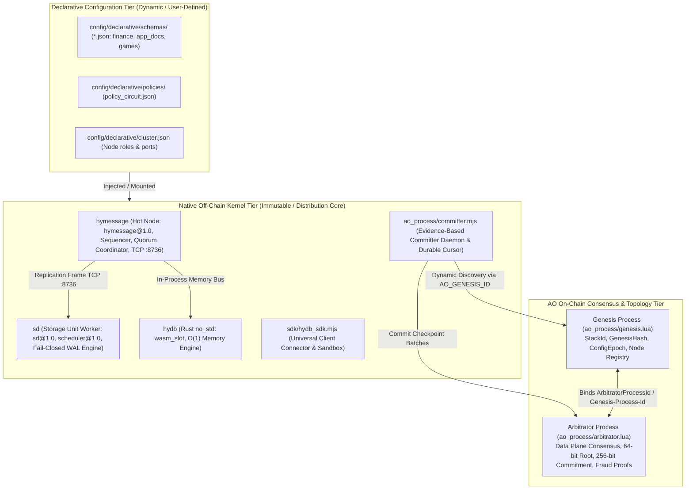

# Universal Distributed Real-Time Database & Fault-Tolerant Compute Stack (AO + HyperBEAM)

> **Sub-15ms Universal Database & Compute Stack with HyDB Core Contract (`hydb.core@1.0`), Canonical Wire Protocol (`hydb.spec/1`), Dual Pluggable Storage Backends (`wasm_slot` & `ets_doc`), Fail-Closed Quorum SD Worker Pool, and Dual-Process AO Genesis & Arbitrator On-Chain Consensus**

[](https://github.com/permaweb/HyperBEAM)
[]()
[](docs/PROTOCOL_AND_FAILURE_MODEL.md)
[](https://ao.g8way.io/)
[](https://www.rust-lang.org/)
[](https://gleam.run/)
[](.github/workflows/ci.yml)

> [!NOTE]
> **Verification Environment & Operational Boundary Disclaimer:**
> - **Audit Baseline & Normative Specification:** Anchored to audit baseline commit `83c76f9` (branch `beta`) with full specifications in [`docs/PROTOCOL_AND_FAILURE_MODEL.md`](docs/PROTOCOL_AND_FAILURE_MODEL.md).
> - **Durability & Quorum Boundaries:** Mutations returning write status `durable` (HTTP 200) require physical persistence from a configured cluster quorum ($Q = \lfloor N/2 \rfloor + 1$ where `HYDB_CLUSTER_SIZE` matches unique entries in `HYDB_CLUSTER_MEMBERS`) executing `file:datasync` to `sd/wal.log` and acknowledging via authenticated TCP. Writes with `write_status: "accepted"` (`commit_status: "provisional"`, `replicated: false`) reside in Hot Node memory and local WAL; provisional mutations are preserved upon Hot Node restart and are not upgraded to `durable` without quorum SD acknowledgement.
> - **Local Simulation vs. L1 Decentralized Finality:** Local test suites execute against the **ArLocal** gateway (`:1984`) and `@permaweb/ao-loader` (`process.wasm` + `arbitrator.lua`). Under `arlocal_local` simulation, maximum settlement status is `settlement_status: "verified"` (`finalized: false`). The status `settlement_status: "finalized"` (`finalized: true`) is strictly claimed on production `ao_network` environments accompanied by verifiable Arweave L1 block confirmations, target Process ID binding, complete commitment tags, and optional multi-gateway consensus.

---

## 1. Architectural Segregation & Topology

To maintain modularity, long-term maintainability, and clean distribution boundaries, HyDB strictly segregates the stack into distinct execution tiers:



1. **On-Chain AO Tier (Dual-Process Architecture)**:
   - **Genesis Process (`ao_process/genesis.lua`)**: Authoritative cluster constitution, canonical `GenesisHash`, authorized node registry (`AuthorizedNodes`, `NodesRegistry`), and cluster health observability (`GetStackStatus`).
   - **Arbitrator Process (`ao_process/arbitrator.lua`)**: Pure data plane verifier executing 64-bit Merkle-XOR and 256-bit SHA-256 state commitment checks, epoch fencing, and fraud proof enforcement.
2. **Native Core Kernel Tier (Immutable)**: The high-throughput execution plane distributed to operators. Requires explicit `HYDB_CLUSTER_SECRET` (minimum 16 bytes; zero guessable fallbacks) and admin authentication token (`HYDB_ADMIN_TOKEN`) for control endpoints.
3. **Declarative Configuration Tier (Dynamic)**: User-defined schemas, policy guardrails, and cluster configurations that can be mounted and upgraded without recompiling the native core.

---

## 2. High-Performance Fast Path & Write Lifecycle

### 2.1 Latency & Performance Profile
- **In-Memory Fast Path**: Sequenced reads and updates execute with sub-15ms round-trip latency on the Hot Node.
- **Bare-Metal WASM Silicon Engine**: Zero-heap 1024-entry Dense Slot Table mapped into process address space provides pure CPU memory bus speeds (~100–300 nanoseconds per operation) with $O(1)$ constant-time Merkle-XOR root updates.
- **Fail-Closed Physical WAL**: Storage Units flush mutations via synchronous `file:datasync` before returning TCP acknowledgements, protecting state across fail-stop crashes without losing durability guarantees.

### 2.2 Write Status Lifecycle (`Hot Node` $\leftrightarrow$ `SD Worker`)
- **`write_status: "durable"` (HTTP 200, `commit_status: "durable"`, `replicated: true`)**: Confirmed persisted by majority quorum ($Q = \lfloor N/2 \rfloor + 1$) of Storage Units via `file:datasync` and reflected in the local Hot WAL and idempotency cache.
- **`write_status: "accepted"` (HTTP 202 / 504 on quorum timeout, `commit_status: "provisional"`, `replicated: false`)**: The event received a monotonic sequence number in memory and was appended to `hot_wal.log` as provisional, but has not yet met SD disk quorum. Startup recovery preserves provisional status and does not promote to durable without verified quorum acknowledgements.
- **Immediate In-Memory Idempotency**: Deduplication cache is populated in RAM before network replication. Retries reusing a `request_id` are served immediately without re-mutating state or appending duplicate frames. Parameter discrepancies trigger HTTP 409 (`ERR_IDEMPOTENCY_KEY_CONFLICT`).

### 2.3 AO Commitment & Settlement Lifecycle (`ao_process/committer.mjs`)
- **`submitted`**: Checkpoint batch dispatched to the AO network (`msg_id` recorded), pending Arbitrator consensus evaluation.
- **`evaluated` / `rejected`**: Arbitrator evaluated the batch and rejected it due to a broken hash chain, sequence gap, or cryptographic fraud (`EQUIVOCATION_PROVEN`).
- **`verified`**: Arbitrator returned an authoritative verdict (`COMMITTED` or `DUPLICATE_BATCH_IDEMPOTENT`) confirming `OfficialSeq`, `OfficialHash`, and `OfficialStateRoot`.
- **`finalized`**: All verification conditions met on production `ao_network` accompanied by mined Arweave L1 block confirmation proofs bound to the message ID, target process, and commitment tags.
- **Fail-Closed Cursor Reconciliation**: The committer persists progress atomically (`committer_cursor.json`) with `fsyncSync`. If local cursor state deviates from or runs ahead of the official AO sequence, the daemon terminates fail-closed (`ERR_CURSOR_AO_STATE_MISMATCH` / `ERR_CURSOR_AHEAD_OF_AO_OFFICIAL_SEQ`).

---

## 3. Storage Backends: `wasm_slot` vs `ets_doc`

| Dimension | `wasm_slot` (Rust WebAssembly) | `ets_doc` (BEAM Concurrent Table) |
| :--- | :--- | :--- |
| **Engine** | Rust `no_std` ([`hydb/src/lib.rs`](hydb/src/lib.rs)) | Erlang Term Storage (ETS) |
| **Key / Value Types** | Monotonic `int64` / `int64` | Flexible string keys / JSON, strings, binaries |
| **Memory Characteristics** | $O(1)$ Dense Slot Array, Zero GC, sub-microsecond access | Highly concurrent, supports nested JSON documents |
| **Rule Enforcement** | Instruction-level within WASM bytecode (`-422`) | Enforced by Erlang schema validation engine |
| **Special Capabilities** | `fast_fingerprint_64`, binary RAM snapshots | Structured querying, prefix scans (`GET /scan`) |
| **Target Use Cases** | High-frequency financial balances, game leaderboards | User profiles, document metadata, NFT catalogs |

---

## 4. Guarantee Matrix & Automated Test Harness (CI Release Gates)

Every guarantee across the HyDB stack is classified as **`Implemented`**, **`Tested`**, or **`Cross-Language Golden-Vector Tested`** (see details in [`docs/PROTOCOL_AND_FAILURE_MODEL.md`](docs/PROTOCOL_AND_FAILURE_MODEL.md)) and verified deterministically in GitHub Actions (`.github/workflows/ci.yml`):

| Phase | Test Suite Name | NPM Script / Test File | Guarantee Classification |
| :---: | :--- | :--- | :---: |
| **00** | **Cross-Language Golden Conformance** | `npm run test:conformance` ([`tests/contract_conformance.mjs`](tests/contract_conformance.mjs)) | `Cross-Language Golden-Vector Tested` & `Tested` |
| **01** | **Control Endpoint & Secret Security** | `npm run test:security` ([`tests/test_tahap01_security.mjs`](tests/test_tahap01_security.mjs)) | `Implemented` & `Tested` |
| **02** | **Fail-Closed WAL Recovery & Integrity** | `npm run test:recovery` ([`tests/test_tahap02_wal_recovery.mjs`](tests/test_tahap02_wal_recovery.mjs)) | `Implemented` & `Tested` |
| **03** | **Canonical Hash & Fixed Quorum** | `npm run test:quorum` ([`tests/test_tahap03_quorum_hash.mjs`](tests/test_tahap03_quorum_hash.mjs)) | `Cross-Language Golden-Vector Tested` & `Tested` |
| **04** | **Write Idempotency & Provisional Status** | `npm run test:idempotency` ([`tests/test_tahap04_idempotency.mjs`](tests/test_tahap04_idempotency.mjs)) | `Implemented` & `Tested` |
| **05** | **Real Multi-Process Chaos & Fault Injection** | `npm run test:chaos` ([`tests/fault_injection_chaos.mjs`](tests/fault_injection_chaos.mjs)) | `Implemented` & `Tested` |
| **06** | **Evidence-Based AO Committer & Cursor** | `npm run test:committer` ([`tests/test_tahap06_ao_committer.mjs`](tests/test_tahap06_ao_committer.mjs)) | `Implemented` & `Tested` |
| **07** | **Documentation & Release Gate Audit** | `npm run test:release-gate` ([`tests/test_tahap07_release_gate.mjs`](tests/test_tahap07_release_gate.mjs)) | `Implemented` & `Tested` |
| **08** | **Developer SDK & Manifest Hashing** | `npm run test:sdk` ([`tests/test_tahap8_sdk_manifest.mjs`](tests/test_tahap8_sdk_manifest.mjs)) | `Implemented` & `Tested` |
| **09** | **AO Genesis Block & Master Contract** | `npm run test:genesis` ([`tests/test_tahap09_genesis_contract.mjs`](tests/test_tahap09_genesis_contract.mjs)) | `Implemented` & `Tested` |
| **10** | **SDK Spawner & Stack Genesis Integration** | `npm run test:spawner` ([`tests/test_tahap10_sdk_spawner.mjs`](tests/test_tahap10_sdk_spawner.mjs)) | `Implemented` & `Tested` |
| **Core** | **Arbitrator, Durability & Business Logic** | `npm run test:ao` / `npm run test:durability` / `npm run test:business` | `Implemented` & `Tested` |

---

## 5. Development & Operational Commands

```bash
# 1. Deterministic dependency installation
npm ci

# 2. Build Rust WebAssembly Silicon Engine from source
npm run build:wasm

# 3. Verify cross-language golden vectors
npm run verify:vectors

# 4. Spawn or simulate an AO Genesis Stack
npm run stack:spawn -- --dry-run

# 5. Run complete end-to-end verification suite
npm test

# 6. Execute multi-process network chaos and SIGKILL fault-injection
npm run test:chaos
```
