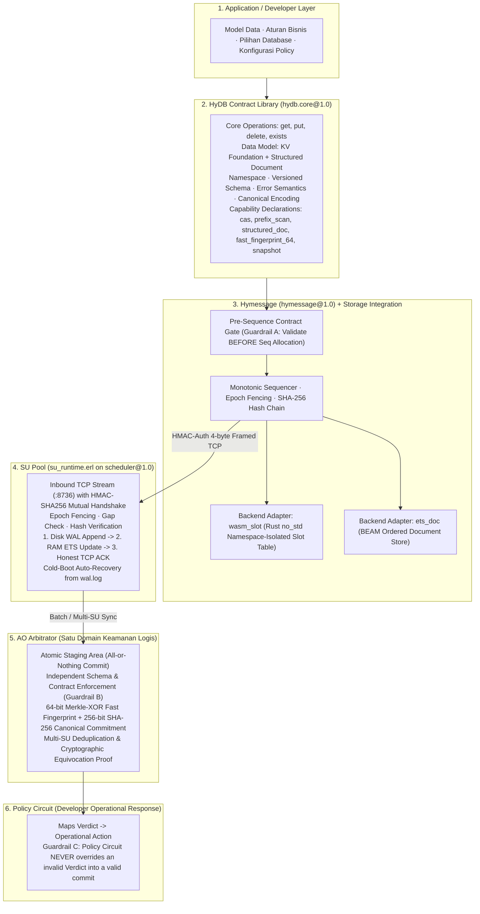

# Universal Distributed Real-Time Database & Fault-Tolerant Compute Stack (AO + HyperBEAM)

> **Sub-15ms Universal Database & Compute Stack with HyDB Core Contract (`hydb.core@1.0`), Pluggable Storage Backends, Honest Durability SU Pool, and Logical Security Domain AO Arbitrator**

[](https://github.com/permaweb/HyperBEAM)
[]()
[](https://ao.g8way.io/)
[-red.svg)](https://www.rust-lang.org/)
[](https://gleam.run/)
[]()

> [!NOTE]
> **Catatan Lingkungan Pengujian (Disclaimer PoC Environment):**
> Seluruh rangkaian pengujian dijalankan dalam **lingkungan lokal 100% (Local Self-Contained Sandbox)** untuk memverifikasi ketahanan kegagalan (*fault-tolerance*), keamanan kriptografis, dan performa tanpa biaya gas/token:
> - **HyperBEAM Dual-Node:** Berjalan lokal di mesin (`:8734` Hot Node, `:8735` SU Node).
> - **Ledger Arweave:** Menggunakan simulator lokal **ArLocal** (`:1984`) sehingga pencatatan blok dan transaksi tidak memerlukan biaya token $AR sesungguhnya.
> - **AO Process Arbitrator:** Menggunakan engine WebAssembly resmi **`@permaweb/ao-loader`** yang mengeksekusi binary proses resmi AO (`process.wasm`) dan skrip Arbitrator Lua (`arbitrator.lua`) + verifier domain keamanan (`real_ao_evaluator.mjs`).

---

## 1. Visi Utama & Pemisahan 6 Lapisan Tanggung Jawab

Stack ini dirancang sebagai **Universal Distributed Real-Time Database dan Compute Stack** yang menggabungkan pemrosesan cepat (`<15ms`), kontrak data universal, replikasi jujur (*honest durability*), verifikasi deterministik, dan pemulihan otomatis ketika node gagal.



---

## 2. HyDB Core Contract Library (`hydb.core@1.0`)

Diimplementasikan pada [`hymessage/src/hydb_contract.erl`](hymessage/src/hydb_contract.erl) dan [`hydb/src/lib.rs`](hydb/src/lib.rs), **HyDB** mendefinisikan arti semantik operasi data secara universal tanpa mencampuradukkan urusan jaringan/konsensus:

### A. Core Contract (Wajib Tersedia)
- **Operasi Dasar:** `get`, `put`, `delete` (`del`), `exists`.
- **Tipe Data:** `int64`, `string`, `bytes`, `bool`, `json`.
- **Namespace & Versioned Schema:** Ruang data terisolasi penuh (termasuk isolasi `ns: u64` di dalam tabel slot Rust WASM `hydb/src/lib.rs` melalui `db_put_ns`/`db_get_ns`/`db_has_ns`/`db_del_ns`/`db_version_ns`), disertai registrasi skema dinamis yang ikut masuk ke urutan sequence WAL (`action = "register_schema"`, opcode `"24"`) sehingga direplikasi ke SU dan ditegakkan secara deterministik oleh Arbitrator AO.
- **Explicit Error Semantics (`error_code`):**
  - `OK` (`200`)
  - `ERR_KEY_NOT_FOUND` (`404`)
  - `ERR_INVALID_INPUT` (`400`)
  - `ERR_SCHEMA_VIOLATION` (`422`)
  - `ERR_VERSION_CONFLICT` (`409` — kegagalan Compare-And-Swap `expected_ver`)
  - `ERR_CAPABILITY_UNSUPPORTED` (`501` — fitur tidak didukung oleh backend namespace terkait)
  - `ERR_NODE_AUTH_FAILED` (penolakan koneksi TCP `:8736` tanpa tanda tangan HMAC-SHA256 yang sah)
- **Canonical Encoding Contract:** Encoding deterministik untuk perhitungan hash chain dan state commitment lintas bahasa (Rust, Erlang, Lua, JavaScript).

### B. Capability & Extension (Deklaratif per Backend)
| Capability | `wasm_slot` (Rust WASM `no_std`) | `ets_doc` (BEAM Ordered Document Store) |
| :--- | :---: | :---: |
| `kv_core` (`get`, `put`, `del`) | ✅ | ✅ |
| `exists` | ✅ | ✅ |
| `cas` (`expected_ver`) | ✅ | ✅ |
| `fast_fingerprint_64` | ✅ | ✅ |
| `snapshot` (WASM linear memory) | ✅ | ❌ (`ERR_CAPABILITY_UNSUPPORTED`) |
| `structured_doc` (String/JSON) | ❌ (`ERR_CAPABILITY_UNSUPPORTED`) | ✅ |
| `prefix_scan` (`GET /scan`) | ❌ (`ERR_CAPABILITY_UNSUPPORTED`) | ✅ |

---

## 3. Tiga Guardrail Keamanan Konstitusional

1. **Guardrail A — Pre-Sequence Contract Gate:**
   Validasi skema, tipe data, kapabilitas backend, dan versi CAS (`expected_ver`) dilakukan **SEBELUM** `Hymessage` mengalokasikan nomor urut `Seq`. Request yang gagal validasi (`400`/`409`/`422`/`501`) ditolak secara bersih tanpa melompati `Seq`, tanpa mengubah rantai hash, dan tanpa mengirim paket sampah ke SU Pool.
2. **Guardrail B — Independent Arbitrator Schema & Commitment Verification:**
   Arbitrator AO tidak percaya buta pada klaim Hot Node maupun SU Node. Arbitrator memvalidasi ulang rantai hash SHA-256, aturan skema bisnis per namespace (termasuk skema dinamis dari event `register_schema`), serta menghitung ulang **64-bit Fast Fingerprint (Merkle-XOR)** dan **256-bit Cryptographic State Commitment (Canonical SHA-256)** di dalam *Atomic Staging Area* (*all-or-nothing*).
3. **Guardrail C — Batas Konstitusional Policy Circuit:**
   Arbitrator menentukan **fakta kriptografis (Verdict)**; `PolicyCircuit` milik developer menentukan tindakan operasional (seperti `REQUEST_CATCHUP_FROM_SU_POOL` atau `FREEZE_EPOCH_AND_PROMOTE_STANDBY_HOT`). Jika konfigurasi `PolicyCircuit` mencoba memaksa menerima batch yang tidak sah (`FORCE_ACCEPT`), guardrail otomatis memblokir override tersebut (`policy_guardrail_enforced: true`) dan menjaga state resmi tetap utuh.

---

## 4. Matriks Verifikasi 14 Fase (`tests/test_maximal_poc.mjs`)

| Fase | Skenario Uji | Jaminan Keamanan & Ketahanan | Status |
| :--- | :--- | :--- | :---: |
| **Phase 1** | **Topology & Native SU Scheduler** | Tepat 1 custom device (`hymessage@1.0`); SU memakai native `scheduler@1.0`. | **PASSED** |
| **Phase 2** | **Honest Durability ACK & `<15ms` Writes** | SU mengirim TCP ACK **setelah** validasi + tulis Disk WAL + update RAM ETS; nilai `-1` tersimpan utuh (`db_has`). | **PASSED** |
| **Phase 3** | **Hash Collision & Tombstone (`SLOT_TOMBSTONE`)** | Linear probing tahan delete (`key=100` & `key=1124`); re-aktivasi tombstone melanjutkan versi (`ver + 1`). | **PASSED** |
| **Phase 4** | **SU Cold-Boot Auto-Recovery dari WAL** | Saat SU restart, RAM ETS otomatis direkonstruksi 100% dari `pool_su/wal.log` (termasuk operasi `del`). | **PASSED** |
| **Phase 5** | **Hot Node Catastrophic Wipe & Replay** | Hot Node kehilangan seluruh RAM $\rightarrow$ replay dari SU WAL memulihkan `Seq`, `Hash`, dan `StateRoot` 100% identik. | **PASSED** |
| **Phase 6** | **Real AO Arbitrator & Dual Commitment** | Rekonstruksi deterministik 64-bit Fast Root + 256-bit Canonical SHA-256 Commitment & mining ke ArLocal. | **PASSED** |
| **Phase 7** | **Multi-SU Deduplication, Out-of-Order, & Gap** | Batch tumpang-tindih diterima idempoten (`DUPLICATE_BATCH_IDEMPOTENT`); urutan acak & gap ditolak. | **PASSED** |
| **Phase 8** | **Multi-SU Equivocation Detection** | Dua SU mengirim data berbeda pada `seq` yang sama $\rightarrow$ terbukti secara kriptografis (`EQUIVOCATION_PROVEN`). | **PASSED** |
| **Phase 9** | **Tampered State Root & Atomic Rollback** | Hash chain valid tetapi `state_root` dipalsukan $\rightarrow$ terdeteksi (`REJECTED_STATE_ROOT_MISMATCH`) & batal atomik. | **PASSED** |
| **Phase 10** | **Split-Brain Prevention & Epoch Fencing** | Promosi ke `Epoch 2` memagari Hot Node zombie (`Epoch 1`) dengan `FENCED_STALE_EPOCH` di Hot, SU, dan Arbitrator. | **PASSED** |
| **Phase 11** | **HyDB Core Contract (`hydb.core@1.0`)** | Pre-sequence schema gate, CAS `expected_ver`, `exists`, multi-backend `wasm_slot` + `ets_doc` `prefix_scan`, & Policy Guardrail. | **PASSED** |
| **Phase 12** | **WASM NS Isolation, Sequenced Schema, & TCP Auth** | Isolasi `ns` di `hydb.wasm` (`default[100]` vs `finance.balances[100]`), event `register_schema` di WAL & Arbitrator, serta Mutual HMAC-SHA256 Auth di TCP `:8736`. | **PASSED** |
| **Phase 13** | **HyDB Contract SDK, Pre-Flight Sandbox & Arweave TX Pull** | `sdk/hydb_sdk.mjs` menjalankan **Pre-Flight Sandbox Simulator** (memvalidasi ekspor WASM, canary execution, non-hanging Lua loop, dan schema invariants) sebelum publish ke Arweave (`Contract_TxID` & `Wasm_TxID`) tanpa URL node. Mendukung custom Lua Policy Handlers ($Y$) berbasis incident context ($X$) dengan proteksi Guardrail C. | **PASSED** |
| **Phase 14** | **Adversarial Security Hardening (5 Lapis Pertahanan)** | Kunci otorisasi admin (`ERR_ADMIN_UNAUTHORIZED`), anti-SSRF gateway (`ERR_UNTRUSTED_GATEWAY`), penegakan `require_auth` kontrak (`ERR_UNAUTHORIZED`), batas kapasitas slot WASM (`ERR_WASM_CAPACITY_EXCEEDED`), dan verifikasi tanda tangan kriptografis batch HMAC SU di Arbitrator AO. | **PASSED** |

---

## 5. Panduan Workflow: Kontrak Murni & Pembuatan Custom WASM Database Engine

### A. Filosofi Desain: SDK adalah "Surat Kontrak Murni", WASM adalah "Mesin Database Fisik"

Di dalam arsitektur HyDB:
- **SDK (`sdk/hydb_sdk.mjs`)** bertindak **murni sebagai pembuat surat kontrak, manifes aturan, dan orkestrator verifikasi**. SDK **tidak** menentukan bagaimana data disimpan di memori.
- **WASM Engine (buatan developer)** adalah **pelaksana fisik database**. Developer bebas mengimplementasikan struktur data apa pun (B-Tree, Hash Slot O(1), LSM-Tree, Vector Index) asalkan mematuhi **Hukum Antarmuka (ABI)** yang disepakati bersama.
- **AO Arbitrator** bertindak sebagai **hakim otonom** yang menjalankan Policy Handler Lua kustom ($Y$) saat terjadi insiden pelanggaran ($X$) di jaringan.

---

### B. Hukum Baku Antarmuka Mesin Database (WASM Storage Engine ABI)

Jika Anda membangun mesin database WASM sendiri (misal dengan Rust, C, atau Zig), biner WASM Anda **wajib mengekspor 5 fungsi primitif dasar** dengan tanda tangan variabel `i64` berikut:

```rust
// Contoh: my_custom_engine/src/lib.rs (Rust no_std / std)

/// 1. TULIS DATA KE STORAGE ENGINE
/// Input:
///   - ns:   ID Namespace unik (i64 hash dari nama namespace)
///   - key:  Kunci record (i64)
///   - val:  Nilai data yang disimpan (i64)
///   - ver:  Nomor versi berurutan (i64)
/// Output: State Root Hash terbaru (i64) hasil kalkulasi mesin Anda.
#[no_mangle]
pub extern "C" fn db_put_ns(ns: i64, key: i64, val: i64, ver: i64) -> i64 {
    // Logika simpan data custom Anda di sini...
    calculate_state_root()
}

/// 2. BACA DATA DARI STORAGE ENGINE
/// Output: Nilai data (i64) yang tersimpan, atau -404 jika tidak ditemukan.
#[no_mangle]
pub extern "C" fn db_get_ns(ns: i64, key: i64) -> i64 {
    // Logika pencarian data custom Anda di sini...
}

/// 3. HAPUS DATA DARI STORAGE ENGINE (Tombstone)
/// Output: State Root Hash terbaru (i64) setelah penghapusan.
#[no_mangle]
pub extern "C" fn db_del_ns(ns: i64, key: i64) -> i64 {
    // Logika penghapusan/tombstone custom Anda di sini...
}

/// 4. CEK KEBERADAAN DATA
/// Output: 1 jika ada (aktif), 0 jika tidak ada atau sudah dihapus.
#[no_mangle]
pub extern "C" fn db_has_ns(ns: i64, key: i64) -> i64 {
    // Return 1 atau 0
}

/// 5. CEK VERSI RECORD SAAT INI (Untuk Optimistic Locking / CAS)
/// Output: Versi data saat ini (i64).
#[no_mangle]
pub extern "C" fn db_version_ns(ns: i64, key: i64) -> i64 {
    // Return nomor versi record
}

/// [OPSIONAL TAPI DIREKOMENDASIKAN] VALIDASI INVARIAN DALAM WASM
/// Output: 0 jika valid, atau kode error negatif (misal -422) jika melanggar invarian internal.
#[no_mangle]
pub extern "C" fn db_check_put_ns(ns: i64, key: i64, val: i64) -> i64 {
    if val < 0 { return -422; } // Tolak nilai negatif langsung di memory WASM!
    0
}
```

Kompilasi engine Anda ke target WebAssembly:
```bash
cargo build --release --target wasm32-unknown-unknown
```

---

### C. Alur Kerja Kontrak: Mengikat Mesin WASM & Kebijakan Lua ($Y$)

Setelah binary `.wasm` Anda selesai dibuat, gunakan SDK untuk memformulasikan kontrak data dan kebijakan darurat:

```javascript
import { defineContract, HYDB_EVENTS } from './sdk/hydb_sdk.mjs';

// 1. Rumuskan Surat Kontrak (Surat Wasiat / Manifes Data)
const myCustomContract = defineContract({
  namespace: 'orderbook.solana',
  backend: 'wasm_slot',
  schema: {
    keyType: 'int64',
    valueType: 'int64',
    minValue: 1,
    maxValue: 1000000000
  },
  // Hubungkan File WASM Custom & Deklarasikan Pemetaan Fungsinya:
  wasm: {
    file: './target/wasm32-unknown-unknown/release/my_engine.wasm',
    exports: {
      put: 'db_put_ns',
      get: 'db_get_ns',
      del: 'db_del_ns',
      has: 'db_has_ns',
      version: 'db_version_ns'
    }
  },
  // Tulis Policy Handler Lua ($Y$) saat terjadi insiden ($X$) di Arbitrator AO:
  policy: {
    [HYDB_EVENTS.ON_SCHEMA_VIOLATION]: `
      return function(event)
        -- event: { verdict, seq, epoch, namespace, sub_verdict, timestamp }
        return "FREEZE_ORDERBOOK_AND_ALERT_ENGINEER"
      end
    `
  }
});

// 2. Pre-Flight Sandbox Simulator & Publish ke Arweave
// Pre-flight secara lokal mengecek:
// - Apakah semua fungsi export di atas beneran ada di binary WASM Anda?
// - Menjalankan canary probe memory execution tanpa panic.
// - Menjalankan simulasi mock event ke fungsi Lua Anda (memastikan bebas hang/infinite loop).
// Jika ada cacat, publish langsung DIBATALKAN seketika (Zero wasted gas/TX)!
const { contractTxId, wasmTxId } = await myCustomContract.publishToArweave({
  gatewayUrl: 'http://127.0.0.1:1984'
});

// 3. Pasang (Mount) Kontrak pada Node Hot Worker
await myCustomContract.mountOnNode('http://127.0.0.1:8734');

// 4. Operasi Database Melalui Bound Client
const db = myCustomContract.bindClient('http://127.0.0.1:8734');
await db.put(1001, 75000); // Mengeksekusi 'db_put_ns' di dalam mesin WASM custom Anda!
const res = await db.get(1001); // { val: 75000, ver: 1 }
```

---

## 6. Protokol Jaringan & Karakteristik Latensi

Stack ini mendukung dua moda interaksi tergantung pada kebutuhan performa aplikasi Anda:

| Moda Transport | Jalur & Port | Karakteristik & Rekomendasi |
| :--- | :--- | :--- |
| **HTTP/1.1 Persistent Keep-Alive** | `http://127.0.0.1:8734/~hymessage@1.0` | **Rekomendasi untuk Web, dApp, & Backend API.** Menggunakan `http.Agent({ keepAlive: true })` untuk menghindari handshake ulang. Menghasilkan latensi RTT klien **~6–8 ms** stabil dengan kompatibilitas HTTP penuh. |
| **Direct Binary TCP Streaming** | `tcp://127.0.0.1:8736` | **Rekomendasi untuk Sinkronisasi Node / Ultra-Low Latency.** Menggunakan protokol biner ber-framing 4-byte dengan otentikasi timbal-balik HMAC. Melewati lapisan HTTP Cowboy secara penuh sehingga latensi penulisan setara dengan durasi engine murni (**~2–3 ms**). |

> [!TIP]
> **Profil Internal Engine:** Mesin internal Hot Node mengeksekusi validasi skema (~16 µs), hashing SHA-256 & state root (~48 µs), replikasi jaringan kuorum ke SU + append ke disk fisik WAL (`file:write`) (~1.1 ms), dan eksekusi slot WASM (~2.6 ms) dengan total durasi internal **p50 = ~3.35 ms**.

---

## 7. Struktur & Klasifikasi Berkas Proyek

Untuk mempermudah pemeliharaan, repositori ini dikelompokkan secara terstruktur:

- **Core Production Engines:**
  - [`hymessage/src/hymessage_runtime.erl`](hymessage/src/hymessage_runtime.erl): GenServer sequencer Hot Node, epoch fencing, dan manajemen TCP stream `:8736`.
  - [`hymessage/src/hydb_contract.erl`](hymessage/src/hydb_contract.erl): Engine deklarasi kapabilitas, pre-sequence gate, CAS, dan isolasi multi-namespace (`hydb.core@1.0`).
  - [`pool_su/src/su_runtime.erl`](pool_su/src/su_runtime.erl): Node SU pemegang otoritas durabilitas WAL fisik, verifikasi hash chain independen, dan auto-recovery RAM dari disk.
  - [`hydb/src/lib.rs`](hydb/src/lib.rs): Engine tabel slot O(1) WebAssembly Rust (`no_std`).
  - [`ao_process/arbitrator.lua`](ao_process/arbitrator.lua): Logika evaluasi AO Arbitrator pada proses WASM resmi AO.
- **Developer SDK:**
  - [`sdk/hydb_sdk.mjs`](sdk/hydb_sdk.mjs): SDK klien JavaScript untuk mendefinisikan kontrak, publish ke Arweave TX, dan berinteraksi dengan database.
- **Official Test Suite (14 Fase):**
  - [`tests/test_maximal_poc.mjs`](tests/test_maximal_poc.mjs): Rangkaian pengujian terpadu mencakup ketahanan kegagalan, multi-SU, Arweave SDK pull, dan 5 lapis pengerasan keamanan adversarial.
- **Internal Benchmarking / Profiling Tools:**
  - `scratch/` (*diabaikan oleh git*): Skrip pengujian latensi internal (`bench.mjs`), pemantau kesehatan cluster (`health.sh`), dan simulasi beban (`traffic.mjs`).

