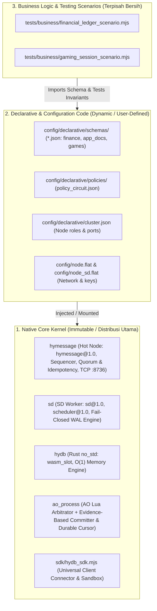
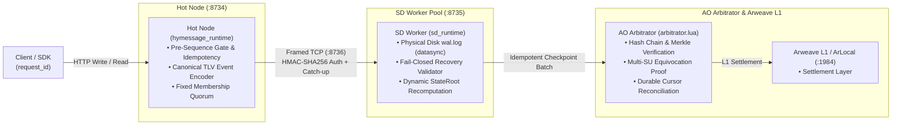

# Universal Distributed Real-Time Database & Fault-Tolerant Compute Stack (AO + HyperBEAM)

> **Sub-15ms Universal Database & Compute Stack with HyDB Core Contract (`hydb.core@1.0`), Canonical Wire Protocol (`hydb.spec/1`), Dual Pluggable Storage Backends (`wasm_slot` & `ets_doc`), Fail-Closed Quorum SD Worker Pool, and Logical Security Domain AO Arbitrator**

[](https://github.com/permaweb/HyperBEAM)
[]()
[](docs/PROTOCOL_AND_FAILURE_MODEL.md)
[](https://ao.g8way.io/)
[](https://www.rust-lang.org/)
[](https://gleam.run/)
[](.github/workflows/ci.yml)

> [!NOTE]
> **Catatan Lingkungan Pengujian & Batas Jaminan (Verification & Boundary Disclaimer):**
> - **Baseline & Spesifikasi Normatif:** Mengacu pada baseline audit commit `83c76f9` (branch `beta`) dengan spesifikasi penuh di [`docs/PROTOCOL_AND_FAILURE_MODEL.md`](docs/PROTOCOL_AND_FAILURE_MODEL.md).
> - **Durability & Quorum:** Write berstatus `durable` (HTTP 200) hanya dikembalikan setelah mayoritas anggota cluster yang dikonfigurasi (`HYDB_CLUSTER_SIZE` harus konsisten dengan jumlah anggota unik di `HYDB_CLUSTER_MEMBERS`, $Q = \lfloor N/2 \rfloor + 1$) melakukan `file:datasync` ke `sd/wal.log` dan mengirim ACK TCP. Write dengan `write_status: "accepted"` (`commit_status: "provisional"`, `replicated: false`) belum mencapai kuorum disk; jika dicatat ke `hot_wal.log`, status `provisional` tetap dipertahankan saat replay restart Hot Node dan **tidak pernah** dinaikkan menjadi `durable` sebelum ACK kuorum SD diterima.
> - **Simulasi Lokal vs Finalitas L1:** Pengujian lokal menggunakan simulator **ArLocal** (`:1984`) dan WASM **`@permaweb/ao-loader`** (`process.wasm` + `arbitrator.lua`). Pada mode `arlocal_local`, status maksimum batch AO adalah `settlement_status: "verified"` (`finalized: false`). Status `settlement_status: "finalized"` (`finalized: true`) hanya diklaim pada jaringan produksi `ao_network` dengan bukti konfirmasi blok L1 Arweave yang terikat ke ID pesan/bundle AO, Process ID target, tag komitmen lengkap (`Batch-Id`, `From-Seq`, `To-Seq`, `State-Root`, `Hash`), serta konsensus multi-gateway opsional.

---

## 1. Pemisahan Tiga Lapisan Arsitektur (Architecture Segregation)

Untuk menjaga stabilitas jangka panjang dan kesiapan distribusi publik, sistem ini memisahkan secara ketat tiga domain kode:



1. **Native Core Kernel (Immutable)**: Kode inti protokol yang didistribusikan ke publik/operator. Wajib dijalankan dengan `HYDB_CLUSTER_SECRET` eksplisit (minimal 16 byte; tanpa fallback default) dan token autentikasi admin (`HYDB_ADMIN_TOKEN`) untuk endpoint kontrol.
2. **Declarative & Configuration Code (Dynamic)**: Skema data JSON, pemetaan sanksi *Policy Circuit*, dan topologi cluster. Pengguna bebas menambah atau mengubah konfigurasi ini tanpa *recompile* kernel native.
3. **Business Logic Scenarios (Isolated)**: Logika pengujian aplikasi bisnis (finansial, game session) yang terisolasi total dari direktori runtime.

---

## 2. Topologi Jaringan, Quorum & Siklus Status Write/AO



### 2.1 Semantik Status Write, Write-Ahead Hot WAL & Idempotensi
- **`write_status: "durable"` (`HTTP 200`, `provisional: false`)**: Event telah di-encode dengan TLV kanonis (`hydb.spec/1`), ditulis mendahului replikasi ke `hot_wal.log`, dikirim melalui TCP terautentikasi (`:8736`), ditulis ke `sd/wal.log` dengan `file:datasync`, dan di-ACK oleh mayoritas anggota cluster (`HYDB_CLUSTER_SIZE` == jumlah `HYDB_CLUSTER_MEMBERS`), lalu dipromosikan ke durable di Hot WAL dan cache idempotensi.
- **`write_status: "accepted"` (`HTTP 202` / `504` saat timeout kuorum, `commit_status: "provisional"`, `replicated: false`)**: Event telah dialokasikan nomor urut `seq` dan ditulis ke `hot_wal.log` sebagai `provisional` di Hot Node namun belum mencapai kuorum disk SD. Replay Hot Node saat startup mempertahankan status provisional ini dan tidak pernah menaikkannya ke durable tanpa ACK kuorum.
- **Idempotensi Segera di RAM & Ketahanan Degradasi**: Cache idempotensi disimpan di RAM sebelum broadcast replikasi ke SD; jika disk Hot WAL mengalami degradasi atau error I/O setelah kuorum SD berhasil, pengiriman ulang (*retry*) dengan `request_id` yang sama selalu dilayani dari cache tanpa memutasi ulang state. Retry dengan parameter payload atau `quorum` berbeda ditolak dengan `HTTP 409 ERR_IDEMPOTENCY_KEY_CONFLICT`. Deduplikasi dibatasi oleh `HYDB_IDEMPOTENCY_MAX_ENTRIES` (default `10.000` entri FIFO).

### 2.2 Semantik Status Komitmen AO & Rekonsiliasi Kursor (`ao_process/committer.mjs`)
- **`submitted`**: Pesan terkirim ke AO (`msg_id` tercatat), tetapi hasil evaluasi Arbitrator belum terverifikasi (`confirmed: false`, `verified: false`).
- **`evaluated` / `rejected`**: Arbitrator mengeksekusi batch namun menolak karena pelanggaran rantai hash, sequence gap, atau pembuktian kecurangan (`EQUIVOCATION_PROVEN`).
- **`verified`**: Arbitrator mengembalikan verdict sah (`COMMITTED` atau `DUPLICATE_BATCH_IDEMPOTENT`) dan `OfficialSeq`, `OfficialHash`, serta `OfficialStateRoot` terkonfirmasi (`verified: true`, `confirmed: true`). Pada simulator `arlocal_local`, status berhenti secara jujur di `verified` (`finalized: false`).
- **`finalized`**: Seluruh syarat `verified` terpenuhi pada jaringan `ao_network` ditambah verifikasi L1 Arweave yang mengikat ID transaksi/bundle ke pesan AO, `target`/`Recipient` ke Process ID Arbitrator, seluruh tag komitmen (`Action: CommitCheckpoint`, `Batch-Id`, `From-Seq`, `To-Seq`, `State-Root`, `Hash`).
  - *Batas Kepercayaan*: Verifikasi 1 gateway diberi label `trust_boundary: "single_gateway_trusted_provider"`; konfigurasi multi-gateway ($\ge 2$ URLs) memverifikasi konsensus `block_indep_hash` dan `block_height` (`multi_gateway_consensus`). Jika `REQUIRE_MULTI_GATEWAY=true` disetel, sistem menolak single-gateway secara fail-closed (`MULTI_GATEWAY_CONSENSUS_REQUIRED`).
- **Rekonsiliasi Kursor Fail-Closed**: Pada saat nomor urut kursor disk sama dengan AO `OfficialSeq`, daemon memverifikasi kesesuaian hash dan state root. Bila terjadi divergensi atau kursor disk mendahului AO, daemon berhenti fail-closed (`ERR_CURSOR_AO_STATE_MISMATCH` / `ERR_CURSOR_AHEAD_OF_AO_OFFICIAL_SEQ`) tanpa memproses batch berikutnya.
- **Arsitektur Pemilik Tunggal (*Single Owner*) & Kunci Berkas**: Daemon dikemas bersama distribusi SD/HyperBEAM (`scripts/start-committer-worker.sh`). Tepat satu replika SD bertindak sebagai pemilik aktif (`HYDB_COMMITTER_ENABLED=true`), sedangkan replika lainnya menonaktifkannya (`HYDB_COMMITTER_ENABLED=false`). Kunci berkas atomik (`committer.lock` dengan deteksi PID OS aktif) mencegah *double settlement* antar proses.
- **Pencegah Crash-Loop (*Exit Code 78 / EX_CONFIG*)**: Pada kondisi fatal fail-closed (divergensi state, ketiadaan `AO_PROCESS_ID` di production, atau konflik kepemilikan lock), daemon keluar dengan exit code `78`. Shell supervisor mendeteksi kode ini dan langsung berhenti tanpa me-restart. Kesalahan sementara (*transient error*) tetap dipulihkan dengan *exponential backoff* hingga 5 kali percobaan.
- **Heartbeat & Pelaporan Status Runtime (`committer_status.json`)**: Status runtime (`idle`, `running`, `halted`, `failed_closed`, `retry_pending`, `stopped`) ditulis berkala di direktori kursor lengkap dengan PID dan timestamp ISO 8601.
- **Pencegahan Pembuatan Proses AO di Mode Produksi**: Pembuatan proses AO otomatis diblokir saat `HYDB_PROFILE=production` (`ERR_AO_PROCESS_ID_REQUIRED`) untuk mencegah keterpisahan state ke proses Arbitrator liar.

---

## 3. Dua Backend Penyimpanan: `wasm_slot` vs `ets_doc`

| Fitur | `wasm_slot` (Rust WebAssembly) | `ets_doc` (BEAM Concurrent Table) |
| :--- | :--- | :--- |
| **Mesin** | Rust `no_std` ([`hydb/src/lib.rs`](hydb/src/lib.rs)) | Erlang Term Storage (ETS) |
| **Tipe Key / Val** | Wajib numerik `int64` / `int64` | String fleksibel / `json`, `string`, `bytes` |
| **Karakteristik** | $O(1)$ Slot Array, Zero-GC, sub-milidetik | Fleksibel, mendukung nested JSON |
| **Batas Aturan** | Ditegakkan langsung di level instruksi WASM (`-422`) | Ditegakkan via parser skema Erlang |
| **Fitur Ekstensi** | `fast_fingerprint_64`, `snapshot` binary RAM | `structured_doc`, `prefix_scan` (`GET /scan`) |
| **Peruntukan Ideal** | Saldo finansial, counter token, state game real-time | Profil pengguna, metadata NFT, katalog dokumen |

---

## 4. Matriks Jaminan & Rangkaian Pengujian Otomatis (CI Release Gate)

Setiap jaminan dalam stack ini diklasifikasikan sebagai **`Implemented`**, **`Tested`**, atau **`Cross-Language Golden-Vector Tested`** (lihat rincian lengkap di [`docs/PROTOCOL_AND_FAILURE_MODEL.md`](docs/PROTOCOL_AND_FAILURE_MODEL.md)) dan dieksekusi secara reproducible di GitHub Actions (`.github/workflows/ci.yml`):

| Fase Roadmap | Rangkaian Uji | Script NPM / Berkas Pengujian | Klasifikasi Jaminan |
| :---: | :--- | :--- | :---: |
| **00** | **Cross-Language Golden Conformance** | `npm run test:conformance` ([`tests/contract_conformance.mjs`](tests/contract_conformance.mjs)) | `Cross-Language Golden-Vector Tested` & `Tested` |
| **01** | **Control Endpoint & Secret Security** | `npm run test:security` ([`tests/test_tahap01_security.mjs`](tests/test_tahap01_security.mjs)) | `Implemented` & `Tested` |
| **02** | **Fail-Closed WAL Recovery & Integrity** | `npm run test:recovery` ([`tests/test_tahap02_wal_recovery.mjs`](tests/test_tahap02_wal_recovery.mjs)) | `Implemented` & `Tested` |
| **03** | **Canonical Hash & Non-Shrinking Quorum** | `npm run test:quorum` ([`tests/test_tahap03_quorum_hash.mjs`](tests/test_tahap03_quorum_hash.mjs)) | `Cross-Language Golden-Vector Tested` & `Tested` |
| **04** | **Write Idempotency & Provisional Status** | `npm run test:idempotency` ([`tests/test_tahap04_idempotency.mjs`](tests/test_tahap04_idempotency.mjs)) | `Implemented` & `Tested` |
| **05** | **Real Multi-Process Chaos & Fault Injection** | `npm run test:chaos` ([`tests/fault_injection_chaos.mjs`](tests/fault_injection_chaos.mjs)) | `Implemented` & `Tested` |
| **06** | **Evidence-Based AO Committer & Cursor** | `npm run test:committer` ([`tests/test_tahap06_ao_committer.mjs`](tests/test_tahap06_ao_committer.mjs)) | `Implemented` & `Tested` |
| **07** | **Documentation & Release Gate Audit** | `npm run test:release-gate` ([`tests/test_tahap07_release_gate.mjs`](tests/test_tahap07_release_gate.mjs)) | `Implemented` & `Tested` |
| **Core** | **AO Arbitrator, Policy & SDK Suites** | `npm run test:ao` / `npm run test:sdk` / `npm run test:business` | `Implemented` & `Tested` |

---

## 5. Perintah Pengujian & Operasional

```bash
# Instalasi dependensi secara deterministik (reproducible)
npm ci

# Menjalankan seluruh rangkaian verifikasi unit, conformance, keamanan, WAL, quorum, idempotensi, AO, dan release gate
npm test

# Menjalankan suite Chaos & Fault Injection multi-proses (proxy jaringan + OS SIGKILL + Oracle audit)
npm run test:chaos
```
