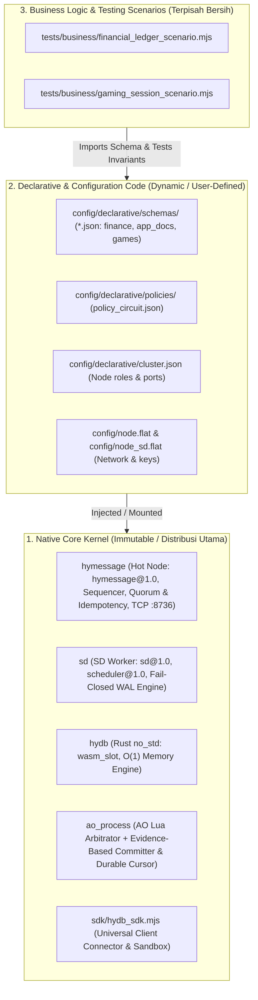
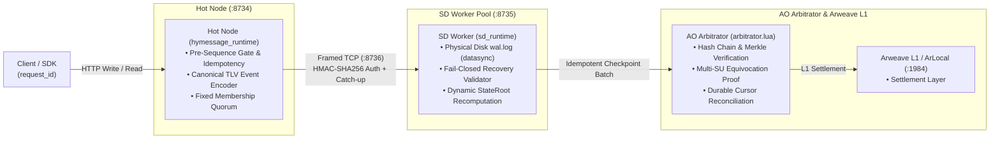

# Universal Distributed Real-Time Database & Fault-Tolerant Compute Stack (AO + HyperBEAM)

> **Sub-15ms Universal Database & Compute Stack with HyDB Core Contract (`hydb.core@1.0`), Canonical Wire Protocol (`hydb.spec/1`), Dual Pluggable Storage Backends (`wasm_slot` & `ets_doc`), Fail-Closed Quorum SD Worker Pool, and Logical Security Domain AO Arbitrator**

[](https://github.com/permaweb/HyperBEAM)
[]()
[](docs/PROTOCOL_AND_FAILURE_MODEL.md)
[](https://ao.g8way.io/)
[-red.svg)](https://www.rust-lang.org/)
[](https://gleam.run/)
[](.github/workflows/ci.yml)

> [!NOTE]
> **Catatan Lingkungan Pengujian & Batas Jaminan (Verification & Boundary Disclaimer):**
> - **Baseline & Spesifikasi Normatif:** Mengacu pada baseline audit commit `83c76f9` (branch `beta`) dengan spesifikasi penuh di [`docs/PROTOCOL_AND_FAILURE_MODEL.md`](docs/PROTOCOL_AND_FAILURE_MODEL.md).
> - **Durability & Quorum:** Write berstatus `durable` (HTTP 200) hanya dikembalikan setelah mayoritas anggota cluster yang dikonfigurasi (`HYDB_CLUSTER_SIZE` / `HYDB_CLUSTER_MEMBERS`, $Q = \lfloor N/2 \rfloor + 1$) melakukan `file:datasync` ke `sd/wal.log` dan mengirim ACK TCP. Write dengan `write_status: "accepted"` (HTTP 202, `provisional: true`) masih berada di RAM Hot Node dan belum dijamin selamat dari crash proses sebelum replikasi selesai.
> - **Simulasi Lokal vs Finalitas L1:** Pengujian lokal menggunakan simulator **ArLocal** (`:1984`) dan WASM **`@permaweb/ao-loader`** (`process.wasm` + `arbitrator.lua`). Pada mode `arlocal_local`, status maksimum batch AO adalah `settlement_status: "verified"` (`finalized: false`). Status `settlement_status: "finalized"` (`finalized: true`) hanya diklaim pada jaringan produksi `ao_network` dengan bukti konfirmasi blok L1 Arweave.

---

## 1. Pemisahan Tiga Lapisan Arsitektur (Architecture Segregation)

Untuk menjaga stabilitas jangka panjang dan kesiapan distribusi publik, sistem ini memisahkan secara ketat tiga domain kode:



1. **Native Core Kernel (Immutable)**: Kode inti protokol yang didistribusikan ke publik/operator. Wajib dijalankan dengan `HYDB_CLUSTER_SECRET` eksplisit (minimal 16 byte; tanpa fallback default) dan token autentikasi admin (`HYDB_ADMIN_TOKEN`) untuk endpoint kontrol.
2. **Declarative & Configuration Code (Dynamic)**: Skema data JSON, pemetaan sanksi *Policy Circuit*, dan topologi cluster. Pengguna bebas menambah atau mengubah konfigurasi ini tanpa *recompile* kernel native.
3. **Business Logic Scenarios (Isolated)**: Logika pengujian aplikasi bisnis (finansial, game session) yang terisolasi total dari direktori runtime.

---

## 2. Topologi Jaringan, Quorum & Siklus Status Write/AO



### 2.1 Semantik Status Write & Idempotensi
- **`write_status: "durable"` (`HTTP 200`, `provisional: false`)**: Event telah di-encode dengan TLV kanonis (`hydb.spec/1`), dikirim melalui TCP terautentikasi (`:8736`), ditulis ke `sd/wal.log` dengan `file:datasync`, dan di-ACK oleh mayoritas anggota cluster (`HYDB_CLUSTER_SIZE`).
- **`write_status: "accepted"` (`HTTP 202`, `provisional: true`)**: Event telah dialokasikan nomor urut `seq` di memori Hot Node (ketika `require_durable=false` saat replika terputus), namun belum mencapai kuorum disk. Pembacaan normal (`GET /get`) menyembunyikan state provisional secara default kecuali diberi parameter `include_provisional=true`. Saat koneksi TCP pulih, Hot Node melakukan *catch-up streaming* otomatis hingga status beralih menjadi `durable`.
- **Idempotensi & Timeout (`request_id`)**: Timeout jaringan tidak otomatis berarti write gagal. Klien wajib menyertakan `request_id` unik; pengiriman ulang (*retry*) dengan `request_id` dan payload identik bersifat idempoten (`idempotent_replay: true`) tanpa menggandakan mutasi atau menaikkan `seq`. Klien dapat memeriksa status akhir melalui `GET /request_status?request_id=<id>`.

### 2.2 Semantik Status Komitmen AO (`ao_process/committer.mjs`)
- **`submitted`**: Pesan terkirim ke AO (`msg_id` tercatat), tetapi hasil evaluasi Arbitrator belum terverifikasi (`confirmed: false`, `verified: false`).
- **`evaluated` / `rejected`**: Arbitrator mengeksekusi batch namun menolak karena pelanggaran rantai hash, sequence gap, atau pembuktian kecurangan (`EQUIVOCATION_PROVEN`).
- **`verified`**: Arbitrator mengembalikan verdict sah (`ACCEPTED_AND_COMMITTED` atau `DUPLICATE_BATCH_IDEMPOTENT`) dan `OfficialSeq` terkonfirmasi (`verified: true`, `confirmed: true`). Pada simulator `arlocal_local`, status berhenti secara jujur di `verified` (`finalized: false`).
- **`finalized`**: Seluruh syarat `verified` terpenuhi pada jaringan `ao_network` ditambah bukti konfirmasi blok Arweave L1 (`finalized: true`).

---

## 3. Dua Backend Penyimpanan: `wasm_slot` vs `ets_doc`

| Fitur | `wasm_slot` (Rust WebAssembly) | `ets_doc` (BEAM Concurrent Table) |
| :--- | :--- | :--- |
| **Mesin** | Rust `no_std` ([`hydb/src/lib.rs`](hydb/src/lib.rs)) | Erlang Term Storage (ETS) |
| **Tipe Key / Val** | Wajib numerik `int64` / `int64` | String fleksibel / `json`, `string`, `bytes` |
| **Karakteristik** | $O(1)$ Slot Array, Zero-GC, sub-milidetik | Fleksibel, mendukung nested JSON |
| **Batas Aturan** | Ditegakkan langsung di level instruksi WASM (`-422`) | Ditegakkan via parser skema Erlang |
| **Fitur Ekstensi** | `fast_fingerprint_64`, `snapshot` binary RAM | `structured_doc`, `prefix_scan` (`GET /scan`) |
| **Peruntukan Ideal** | Saldo finansial, counter token, state game real-time | Profil pengguna, metadata NFT, katalog dokumen |

---

## 4. Matriks Jaminan & Rangkaian Pengujian Otomatis (CI Release Gate)

Setiap jaminan dalam stack ini diklasifikasikan sebagai **`Implemented`**, **`Tested`**, atau **`Proven under model`** (lihat rincian lengkap di [`docs/PROTOCOL_AND_FAILURE_MODEL.md`](docs/PROTOCOL_AND_FAILURE_MODEL.md)) dan dieksekusi secara reproducible di GitHub Actions (`.github/workflows/ci.yml`):

| Fase Roadmap | Rangkaian Uji | Script NPM / Berkas Pengujian | Klasifikasi Jaminan |
| :---: | :--- | :--- | :---: |
| **00** | **Cross-Language Golden Conformance** | `npm run test:conformance` ([`tests/contract_conformance.mjs`](tests/contract_conformance.mjs)) | `Proven under model` & `Tested` |
| **01** | **Control Endpoint & Secret Security** | `npm run test:security` ([`tests/test_tahap01_security.mjs`](tests/test_tahap01_security.mjs)) | `Implemented` & `Tested` |
| **02** | **Fail-Closed WAL Recovery & Integrity** | `npm run test:recovery` ([`tests/test_tahap02_wal_recovery.mjs`](tests/test_tahap02_wal_recovery.mjs)) | `Implemented` & `Tested` |
| **03** | **Canonical Hash & Non-Shrinking Quorum** | `npm run test:quorum` ([`tests/test_tahap03_quorum_hash.mjs`](tests/test_tahap03_quorum_hash.mjs)) | `Proven under model` & `Tested` |
| **04** | **Write Idempotency & Provisional Status** | `npm run test:idempotency` ([`tests/test_tahap04_idempotency.mjs`](tests/test_tahap04_idempotency.mjs)) | `Implemented` & `Tested` |
| **05** | **Real Multi-Process Chaos & Fault Injection** | `npm run test:chaos` ([`tests/fault_injection_chaos.mjs`](tests/fault_injection_chaos.mjs)) | `Implemented` & `Tested` |
| **06** | **Evidence-Based AO Committer & Cursor** | `npm run test:committer` ([`tests/test_tahap06_ao_committer.mjs`](tests/test_tahap06_ao_committer.mjs)) | `Implemented` & `Tested` |
| **07** | **Documentation & Release Gate Audit** | `npm run test:release-gate` ([`tests/test_tahap07_release_gate.mjs`](tests/test_tahap07_release_gate.mjs)) | `Implemented` & `Tested` |
| **Core** | **AO Arbitrator, Policy & SDK Suites** | `npm run test:ao` / `npm run test:sdk` / `npm run test:business` | `Implemented` & `Tested` |

---

## 5. Perintah Pengujian & Operasional

```bash
# Instalasi dependensi secara deterministik (reproducible)
npm ci

# Menjalankan seluruh rangkaian verifikasi unit, conformance, keamanan, WAL, quorum, idempotensi, AO, dan release gate
npm test

# Menjalankan suite Chaos & Fault Injection multi-proses (proxy jaringan + OS SIGKILL + Oracle audit)
npm run test:chaos
```
