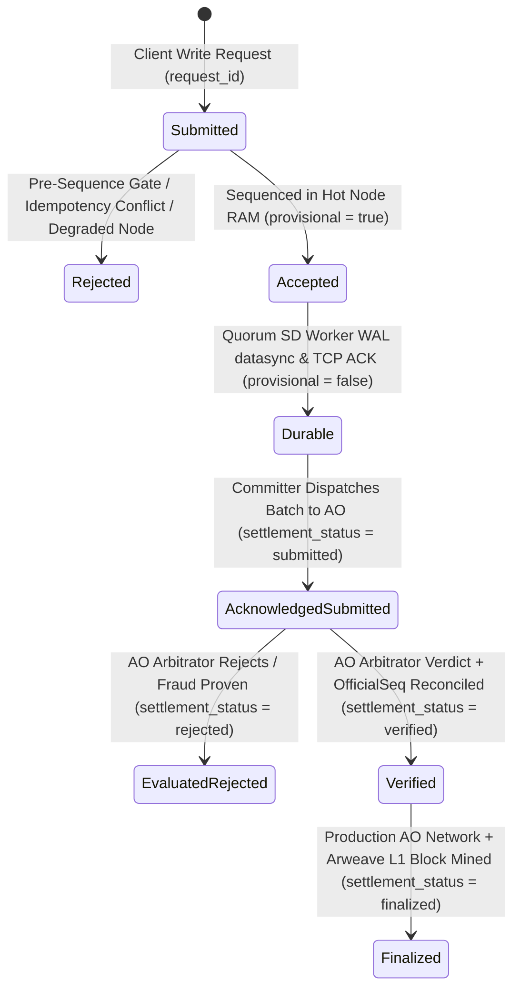

# HyDB Protocol, Components & Failure Model Specification

> **Normative Specification:** System Guarantees, Quorum & Durability Boundaries, Crash Recovery Semantics, Idempotency Contracts, AO Settlement Lifecycle, and Verification Traceability.
> **Audit Baseline Commit:** `83c76f9` (Branch: `beta`)
> **Protocol Version:** `hydb.core@1.0` / Canonical TLV Wire Format `hydb.spec/1` (`0x48 0x59`, version `0x01`)

---

## 1. Baseline & Component Inventory

This specification is anchored from baseline commit **`83c76f9`** on branch `beta` and tracks the hardened release gates across Phases `00` through `07`. Every guarantee in this document is classified using three strict verification levels:

- **`Implemented`**: Enforced in production code paths (Erlang BEAM, Rust WASM, Lua AO, or ESM SDK).
- **`Tested`**: Verified by automated deterministic unit, integration, or multi-process fault-injection tests executed in CI (`.github/workflows/ci.yml`).
- **`Proven under model`**: Mathematically or deterministically invariant across all implementations via shared canonical golden vectors (`spec/golden_vectors.json`) or bounded state-machine verification under the stated failure assumptions.

### 1.1 Core Stack Components

| Component | Repository Path | Runtime / Technology | Role & Responsibilities |
| :--- | :--- | :--- | :--- |
| **Hot Node Sequencer** | `hymessage/` | Gleam + Erlang BEAM (`~hymessage@1.0`) | Primary sequencer, HTTP API (`:8734`), Pre-Sequence Gate, Idempotency Ledger, Fixed-Quorum Coordinator, Framed TCP Replication Server (`:8736`). |
| **SD Worker Pool** | `sd/` | Gleam + Erlang BEAM (`~sd@1.0`, `~scheduler@1.0`) | Shared Data Pool replica, HTTP API (`:8735`), Framed TCP Replication Client (`:8736`), Disk WAL Engine (`sd/wal.log`) with `file:datasync`, fail-closed recovery validator, ETS state mirror. |
| **HyDB Silicon Engine** | `hydb/` | Rust `no_std` (WASM32 `hydb.wasm`) | $O(1)$ dense slot table (1024 slots), tombstone-preserving linear probing, in-WASM boundary validation (`min_value`, `max_value`, `max_records`), rolling 64-bit Merkle-XOR `StateRoot`. |
| **AO Arbitrator & Committer** | `ao_process/` | Lua (`arbitrator.lua`) + ESM (`committer.mjs`, `committer_daemon.mjs`) | Independent hash-chain & state-commitment verifier, equivocation detector, Constitutional Guardrail C, durable checkpoint cursor (`committer_cursor.json`), evidence-based settlement status classifier. |
| **Universal Client SDK** | `sdk/` | JavaScript / ESM (`hydb_sdk.mjs`) | Declarative contract builder (`defineContract`), WASM sandbox preflight (`preflightDryRun`), Arweave manifest publisher, namespace client. |
| **Normative Specification** | `spec/` | JavaScript / ESM (`hydb_contract_spec.mjs`, `golden_vectors.json`) | Normative Canonical TLV event encoding, FNV-1a / SHA-256 hash chain definitions, 64-bit Merkle-XOR & 256-bit state commitment algorithms, and cross-language golden vectors. |

---

## 2. Write & Settlement Status Lifecycle

HyDB separates **local sequencing**, **replica WAL durability**, **AO cryptographic verification**, and **Arweave L1 finality** into distinct, non-conflated statuses.

### 2.1 Write Status Semantics (`Hot Node` $\leftrightarrow$ `SD Worker`)

| `write_status` | HTTP Code | `provisional` | Formal Condition | Durability & Visibility Boundary | Verification Status & Suite |
| :--- | :---: | :---: | :--- | :--- | :--- |
| **`accepted`** | `202` | `true` | Request passed Pre-Sequence Gate and received a monotonic `seq`, but configured quorum ACK was not yet met (e.g., `require_durable=false` during replica disconnect). | **Provisional in Hot Node RAM only.** Never reported as committed/durable. Normal reads (`GET /get`) hide provisional mutations by default unless `include_provisional=true` is explicitly requested. Vulnerable to loss if Hot Node crashes before TCP catch-up replication completes. | **Implemented & Tested** (`tests/test_tahap04_idempotency.mjs`, `tests/fault_injection_chaos.mjs`) |
| **`durable`** | `200` | `false` | Event encoded in Canonical TLV, transmitted over authenticated TCP (`:8736`), appended to `sd/wal.log`, flushed via `file:datasync`, and acknowledged by a majority quorum ($Q = \lfloor N/2 \rfloor + 1$) of configured cluster members. | Survives fail-stop OS process crashes (`SIGKILL`) of the Hot Node or individual SD Workers, **provided at least one intact quorum WAL replica remains accessible**. | **Implemented, Tested & Proven under model** (`tests/test_tahap03_quorum_hash.mjs`, `tests/fault_injection_chaos.mjs`) |
| **`unknown`** | `404` / Timeout | `null` | Client experienced an HTTP/network timeout before receiving a response, or queried `/request_status` for an unseen `request_id`. | **Timeout does NOT imply write failure.** The mutation may be `accepted`, `durable`, or never reached the sequencer. Client must query `GET /request_status?request_id=<id>` or retry with the identical `request_id`. | **Implemented & Tested** (`tests/test_tahap04_idempotency.mjs`, `tests/fault_injection_chaos.mjs`) |

### 2.2 AO Settlement Status Semantics (`ao_process/committer.mjs`)

A batch submission to AO is **never** marked `confirmed: true` merely because `message()` or an HTTP gateway post returned a message/transaction ID.

| `settlement_status` | `verified` | `confirmed` | `finalized` | Required Cryptographic / Operational Evidence | Verification Status & Suite |
| :--- | :---: | :---: | :---: | :--- | :--- |
| **`submitted`** | `false` | `false` | `false` | `message()` or gateway TX post returned a `msg_id` / `tx_id`, but Arbitrator evaluation result is pending or unverified (`evaluation_status: "pending"`). | **Implemented & Tested** (`tests/test_tahap06_ao_committer.mjs`) |
| **`rejected`** | `false` | `false` | `false` | Arbitrator evaluated the batch and returned a rejection verdict (`REJECTED_*`, `EQUIVOCATION_PROVEN`, `FENCE_AND_DROP_ZOMBIE_HOT`). | **Implemented & Tested** (`tests/test_tahap06_ao_committer.mjs`, `tests/test_tahap6_ao_arbitrator.mjs`) |
| **`verified`** | `true` | `true` | `false` | Arbitrator evaluated the batch (`ACCEPTED_AND_COMMITTED` or `DUPLICATE_BATCH_IDEMPOTENT` with matching hash) **and** official state inspection confirms `OfficialSeq >= batch.to_seq`. On `arlocal_local` (`127.0.0.1:1984`), settlement stops at `verified` (`finalized: false`) because local simulation does not provide decentralized L1 finality. | **Implemented & Tested** (`tests/test_tahap06_ao_committer.mjs`) |
| **`finalized`** | `true` | `true` | `true` | All requirements of `verified` are met on a target **`ao_network`** deployment **plus** explicit Arweave L1 block finality proof (`l1_confirmed === true` and `l1_tx_id`). | **Implemented & Tested** (`tests/test_tahap06_ao_committer.mjs`) |
| **`unknown`** | `false` | `false` | `false` | Transport failure or timeout prevented evidence collection; daemon preserves `lastCommittedSeq` without advancing cursor and retries idempotently. | **Implemented & Tested** (`tests/test_tahap06_ao_committer.mjs`) |

---

## 3. Protocol Guarantees, Assumptions & Failure Model

### 3.1 Canonical Event Encoding & Hash Protocol (`Phase 03`)
* **Normative Definition**: Every sequenced mutation (`PUT` op `1`, `DEL` op `2`) is serialized into the canonical binary TLV record format (`0x48 0x59`, version `1`, `op`, `seq:64/big`, `epoch:32/big`, `key_len:16/big`, `key`, `val_len:32/big`, `val`) before computing the 64-bit FNV-1a chain link (`compute_chain_hash(PrevHash, TlvBytes)`) and 64-bit Merkle-XOR state root (`canonical_hash_64(Key, Val, Ver)`).
* **Cross-Language Invariance**: JavaScript (`spec/hydb_contract_spec.mjs`), Erlang (`hymessage_runtime.erl`, `sd_runtime.erl`, `hydb_spec.erl`), Rust WASM (`hydb/src/lib.rs`), and Lua (`ao_process/arbitrator.lua`) execute the identical byte-level algorithm verified against `spec/golden_vectors.json`.
* **Status**: **Proven under model & Tested** (`tests/contract_conformance.mjs`, `tests/test_tahap03_quorum_hash.mjs`).

### 3.2 Fixed Cluster Membership & Non-Shrinking Quorum (`Phase 03`)
* **Quorum Assumption**: Cluster membership size $N$ is determined by explicit configuration (`HYDB_CLUSTER_SIZE` or `HYDB_CLUSTER_MEMBERS`), never by counting currently connected TCP subscriber sockets.
* **Partition Invariant**: The required durability quorum majority is fixed at:
  $$Q = \lfloor N / 2 \rfloor + 1$$
  If SD Worker connections drop below $Q$, the Hot Node **never** lowers $Q$. Requests with `require_durable=true` fail-closed with `HTTP 503 ERR_DURABILITY_UNSATISFIED` until at least $Q$ configured cluster members acknowledge WAL persistence.
* **Status**: **Implemented & Tested** (`tests/test_tahap03_quorum_hash.mjs`, `tests/fault_injection_chaos.mjs` Scenario 2).

### 3.3 Request Idempotency & Deduplication (`Phase 04`)
* **Contract**: Clients attach a unique `request_id` (or `idempotency_key` / `x-request-id` header) to `/put`, `/del`, and `/schema` requests.
* **Retry Guarantee**: Retrying an identical request (`op`, `ns`, `key`, `val`, `request_id`) returns the original sequence number and state root (`idempotent_replay: true`) without allocating a new `seq`, mutating state twice, or appending duplicate WAL frames. Reusing the same `request_id` with a different payload or operation is rejected with `HTTP 409 ERR_IDEMPOTENCY_KEY_CONFLICT`.
* **Status**: **Implemented & Tested** (`tests/test_tahap04_idempotency.mjs`, `tests/fault_injection_chaos.mjs` Scenario 5).

### 3.4 Fail-Closed WAL Recovery & Corruption Detection (`Phase 02`)
* **Cold-Boot Verification**: On startup or `/recover`, `sd_runtime` scans `sd/wal.log` from byte offset `0`, verifying frame magic (`0x48 0x59 0x57 0x4C`), monotonic sequence numbers (`Seq == PrevSeq + 1`), unbroken `prev_hash` linkage, canonical TLV event hash match, and non-decreasing epoch numbers.
* **Independent State Root Recomputation**: Recovery rebuilds the in-memory ETS state from validated events and dynamically recomputes `state_root` via `canonical_hash_64/3` across all active non-tombstone records. It never blindly trusts a stored root field in the WAL.
* **Crash Truncation vs. Mid-File Corruption**:
  - *Clean EOF Crash Truncation*: An incomplete trailing frame at the very end of `wal.log` caused by an OS crash during write is cleanly truncated (`eof_truncated_bytes > 0`) when enabled (`truncate_clean_eof`), recovering up to the last complete frame.
  - *Mid-File Corruption / Tampering*: Any corrupted magic header, hash mismatch, sequence gap, or epoch regression transitions the SD node into **`node_health: "degraded"` (`corrupted: true`)**. A degraded node refuses all new writes and replication appends (`HTTP 503 ERR_WAL_CORRUPTED_DEGRADED`) until operator intervention.
* **Status**: **Implemented & Tested** (`tests/test_tahap02_wal_recovery.mjs`, `tests/fault_injection_chaos.mjs` Scenario 3).

### 3.5 Control Endpoint Authentication & Cluster Secret Security (`Phase 01`)
* **Mandatory Cluster Secret**: Neither Hot Node nor SD Worker permits any hardcoded default fallback secret. Startup fails immediately (`missing_or_weak_cluster_secret`) if `HYDB_CLUSTER_SECRET` is unset or shorter than 16 bytes.
* **Admin Control Plane Protection**: Administrative endpoints (`/reset`, `/fence_epoch`, `/simulate_restart`, `/promote`) require explicit constant-time authentication via `x-admin-token` / `admin_token` matching `HYDB_ADMIN_TOKEN`. Furthermore, destructive test endpoints (`/reset`, `/simulate_restart`) are strictly disabled (`HTTP 403 ERR_TEST_ENDPOINT_DISABLED`) unless `HYDB_PROFILE=test`.
* **Status**: **Implemented & Tested** (`tests/test_tahap01_security.mjs`).

### 3.6 Epoch Fencing & Zombie Hot Node Rejection (`Phase 01 & 05`)
* **Split-Brain Defense**: When an operator or AO Arbitrator promotes the cluster to `Epoch E + 1`, both Hot Node and SD Worker persist the fenced epoch. Any write or replication frame carrying `Epoch < CurrentEpoch` is rejected (`HTTP 409 FENCED_STALE_EPOCH` on Hot Node; dropped on SD Worker; `FENCE_AND_DROP_ZOMBIE_HOT` on AO Arbitrator) without mutating state or WAL.
* **Status**: **Implemented & Tested** (`tests/fault_injection_chaos.mjs` Scenario 6, `tests/test_maximal_poc.mjs`).

### 3.7 Durable AO Committer Cursor & Idempotent Batch Retries (`Phase 06`)
* **Cursor Persistence & Reconciliation**: `ao_process/committer_daemon.mjs` persists `lastCommittedSeq` and `lastCommittedHash` atomically to disk (`committer_cursor.json`) and reconciles with the AO Arbitrator (`GetOfficialState`) on startup (`max(localCursor, officialSeq)`), preventing sequence reset to `0` after daemon restarts.
* **Batch Idempotency & Equivocation Detection**: Retrying a already-committed batch `[from_seq, to_seq]` with an identical final hash returns `DUPLICATE_BATCH_IDEMPOTENT` without creating duplicate entries in `Checkpoints`. Submitting an overlapping batch whose hash conflicts with `EventHistory[to_seq].hash` triggers cryptographic fraud rejection (`EQUIVOCATION_PROVEN`).
* **Status**: **Implemented & Tested** (`tests/test_tahap06_ao_committer.mjs`).

### 3.8 Scope Boundaries & Explicit Non-Claims
To maintain engineering rigor, HyDB explicitly states the boundaries where guarantees depend on external infrastructure:
1. **No Unqualified "Zero Data Loss"**:
   - mutations with `write_status: "accepted"` (`provisional: true`) reside only in Hot Node RAM until TCP catch-up replication finishes and **can be lost** if the Hot Node process is killed (`SIGKILL`) before replication.
   - mutations with `write_status: "durable"` survive fail-stop crashes of the Hot Node or up to $N - Q$ SD replicas, **conditional on at least one intact WAL file (`sd/wal.log`) surviving on disk without media destruction**.
2. **No Unqualified "Irreversible Finality" on Local Simulation**:
   - Local tests running against ArLocal (`127.0.0.1:1984`) and in-memory WASM `@permaweb/ao-loader` verify deterministic state-machine execution (`settlement_status: "verified"`, `finalized: false`), **not** decentralized censorship-resistant finality. True L1 finality (`settlement_status: "finalized"`, `finalized: true`) requires deployment to the production AO network and confirmed Arweave L1 block settlement.

---

## 4. Guarantee & Verification Traceability Matrix

| Phase | Roadmap Workstream | Guarantee Classification | Primary Implementation Files | Automated Verification Suite |
| :---: | :--- | :---: | :--- | :--- |
| **00** | **Reproducible Baseline & CI** | `Implemented` & `Tested` | `.github/workflows/ci.yml`, `package.json` | GitHub Actions CI (`npm ci` + all suites) |
| **01** | **Control Endpoint & Secret Security** | `Implemented` & `Tested` | `sd/src/sd_runtime.erl`, `hymessage/src/hymessage_runtime.erl` | `npm run test:security` (`tests/test_tahap01_security.mjs`) |
| **02** | **Fail-Closed WAL Recovery & Integrity** | `Implemented` & `Tested` | `sd/src/sd_runtime.erl` | `npm run test:recovery` (`tests/test_tahap02_wal_recovery.mjs`) |
| **03** | **Canonical Hash & Fixed Quorum** | `Proven under model` & `Tested` | `spec/hydb_contract_spec.mjs`, `spec/golden_vectors.json`, `hymessage/src/hymessage_runtime.erl`, `sd/src/sd_runtime.erl`, `hydb/src/lib.rs`, `ao_process/arbitrator.lua` | `npm run test:conformance` (`tests/contract_conformance.mjs`) & `npm run test:quorum` (`tests/test_tahap03_quorum_hash.mjs`) |
| **04** | **Write Idempotency & Provisional Status** | `Implemented` & `Tested` | `hymessage/src/hymessage_runtime.erl` | `npm run test:idempotency` (`tests/test_tahap04_idempotency.mjs`) |
| **05** | **Multi-Process Chaos & Fault Injection** | `Implemented` & `Tested` | `tests/chaos_node_daemon.escript`, `tests/fault_injection_chaos.mjs` | `npm run test:chaos` (`tests/fault_injection_chaos.mjs`) |
| **06** | **Evidence-Based AO Committer & Cursor** | `Implemented` & `Tested` | `ao_process/committer.mjs`, `ao_process/committer_daemon.mjs`, `ao_process/arbitrator.lua` | `npm run test:committer` (`tests/test_tahap06_ao_committer.mjs`) |
| **07** | **Documentation & Release Gate Audit** | `Implemented` & `Tested` | `docs/PROTOCOL_AND_FAILURE_MODEL.md`, `README.md`, `tests/test_tahap07_release_gate.mjs` | `npm run test:release-gate` (`tests/test_tahap07_release_gate.mjs`) |
