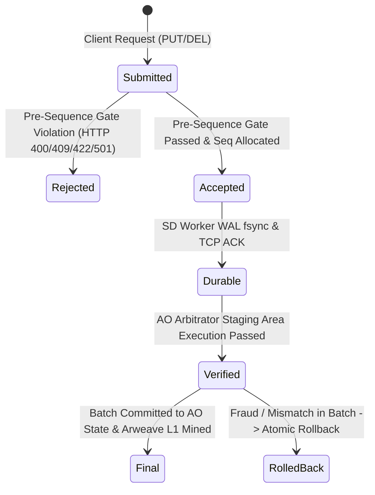

# HyDB Protocol, Components & Failure Model Specification

> **Normative Document:** Defining System Guarantees, Architectural Components, Failure Models, Status Lifecycle, and Verification Procedures.
> **Baseline Commit:** `ccce578` (Branch: `beta`)

---

## 1. Baseline & Component Inventory

This audit and verification baseline is anchored at commit **`ccce578`** on branch `beta`.

### 1.1 Core Components

| Component | Repository Path | Runtime / Technology | Role & Responsibilities |
| :--- | :--- | :--- | :--- |
| **Hot Node Sequencer** | `hymessage/` | Gleam + Erlang BEAM (`~hymessage@1.0`) | Primary sequencer, HTTP Cowboy API (`:8734`), Pre-Sequence Gate, Monotonic Sequencer, In-memory cache, TCP Streaming Server (`:8736`). |
| **SD Worker Pool** | `sd/` | Gleam + Erlang BEAM (`~sd@1.0`, `~scheduler@1.0`) | Shared Data Pool replica, HTTP API (`:8735`), TCP Streaming Client (`:8736`), Disk WAL Engine (`sd/wal.log`) with `file:datasync`, in-memory ETS mirror, checkpoint batch provider. |
| **HyDB Silicon Engine** | `hydb/` | Rust `no_std` (WASM32 `hydb.wasm`) | $O(1)$ dense slot table (1024 slots), tombstone-preserving linear probing, in-WASM boundary validation (`min_value`, `max_value`, `max_records`), rolling 64-bit Merkle-XOR StateRoot. |
| **AO Arbitrator** | `ao_process/` | Lua (`arbitrator.lua`) on AO WASM | Universal Security Domain & finality authority, deterministic hash chain verification, multi-SU equivocation detection, constitutional Guardrail C, 256-bit canonical state commitment, Arweave settlement. |
| **Universal Client SDK** | `sdk/` | JavaScript / ESM (`hydb_sdk.mjs`) | Fluent `defineContract`, `preflightDryRun` (WASM ABI exports verification, canary probe, policy allowlist validation), Arweave manifest publisher, namespace client. |
| **Protocol Specification**| `spec/` | JavaScript / ESM (`hydb_contract_spec.mjs`) | Normative specification for Canonical TLV encoding, Value Model, Hash Chain algorithm, State Commitment, and Policy Allowlist. |

---

## 2. Transaction Status Lifecycle

Every state mutation in the HyDB ecosystem transitions through four mathematically and operationally distinct statuses:

### 2.1 Semantics & Verifiable Definitions

| Status | Formal Definition | Operational Guarantee | Verification Method |
| :--- | :--- | :--- | :--- |
| **`ACCEPTED`** | Request passed Pre-Sequence Gate (rules, CAS `expected_ver`, auth token, backend capabilities). A monotonic sequence number `Seq` is assigned in Hot Node RAM. | State mutation is sequenced and reflected in Hot Node memory cache. **Not yet guaranteed to survive crash.** | `tests/test_tahap3_enforcement.mjs` (pre-sequence rejection test) & `tests/business/*.mjs`. |
| **`DURABLE`** | Event is transmitted over framed TCP (`:8736`), appended to `sd/wal.log`, flushed via `file:datasync`, mirrored into SD RAM ETS, and acknowledged via TCP ACK (`<<Seq:32/big>>`). | Guaranteed to survive crash of Hot Node or SD Worker. Zero Data Loss within quorum. | `tests/test_tahap5_durability.mjs` & `tests/test_maximal_poc.mjs` (Phase 2 & Phase 4). |
| **`VERIFIED`** | A checkpoint batch containing the event is re-executed in the AO Arbitrator's Staging Area. Hash chain, 64-bit Merkle-XOR root, 256-bit canonical commitment, and contract schemas match without contradiction. | Proven mathematically free of fraud, sequence gaps, and equivocation. | `tests/test_tahap6_ao_arbitrator.mjs` & `tests/test_maximal_poc.mjs` (Phase 6 & 9). |
| **`FINAL`** | The verified checkpoint batch is promoted to `OfficialSeq` in the AO Arbitrator process and an Arweave L1 settlement transaction is confirmed/mined on-chain. | Censorship-resistant, immutable, decentralized global finality. Cannot be reverted. | `tests/test_maximal_poc.mjs` (Phase 6 & 13) via ArLocal block mining. |

---

## 3. Failure Model & Threat Invariants

The HyDB architecture is formally resilient against the following failure categories:

### 3.1 Crash-Stop & Process Restart
* **Hot Node Wipe / Crash**:
  - *Failure Condition*: Hot Node process is terminated (`SIGKILL`) or memory wiped (`Seq = 0, Root = 0`).
  - *Recovery Guarantee*: Replaying verified events from `sd/wal.log` reconstructs exact `Seq`, `Hash`, and `StateRoot` with **Zero Data Loss**.
  - *Verification*: `tests/test_maximal_poc.mjs` (Phase 5).
* **SD Worker Crash / Restart**:
  - *Failure Condition*: SD Worker terminates unexpectedly.
  - *Recovery Guarantee*: Cold-boot recovery reads `sd/wal.log`, verifies hash chain continuity, and rebuilds 100% of RAM ETS state including tombstones.
  - *Verification*: `tests/test_maximal_poc.mjs` (Phase 4).

### 3.2 Network Partitions & Stream Failures
* **Hot Node $\leftrightarrow$ SD Worker Disconnect**:
  - *Failure Condition*: TCP stream `:8736` severed.
  - *Guarantee*: Hot Node fails-closed; if durability quorum is unsatisfied, mutations return `ERR_DURABILITY_UNSATISFIED`. Unacknowledged writes are not marked durable.
  - *Verification*: `tests/test_tahap5_durability.mjs`.
* **Rogue Node Injection**:
  - *Failure Condition*: Unauthorized node attempts to connect to TCP `:8736`.
  - *Guarantee*: Handshake without valid HMAC-SHA256 signature is rejected immediately (`ERR_NODE_AUTH_FAILED`).
  - *Verification*: `tests/test_tahap5_durability.mjs` & `tests/test_maximal_poc.mjs` (Phase 12).

### 3.3 Corrupted, Truncated, or Gapped WAL
* **WAL Truncation / Broken Hash Chain**:
  - *Failure Condition*: Partial bytes appended or byte modified in `sd/wal.log`.
  - *Guarantee*: Recovery halts at first broken hash chain; Arbitrator rejects batch with `REJECTED_HASH_CHAIN_BROKEN` / `FRAUD_DETECTED_AND_CUT`.
  - *Verification*: `tests/test_maximal_poc.mjs` (Phase 7 & 9).
* **Sequence Gap**:
  - *Failure Condition*: Batch misses events (e.g., jumps from Seq 25 to 30).
  - *Guarantee*: Arbitrator halts batch processing, returns `REJECTED_SEQUENCE_GAP`, triggers policy `REQUEST_CATCHUP_FROM_SD_POOL`.
  - *Verification*: `tests/test_maximal_poc.mjs` (Phase 7).

### 3.4 Stale Node & Split-Brain (Epoch Fencing)
* **Zombie Hot Node Attack**:
  - *Failure Condition*: Standby Hot Node promoted to `Epoch 2`. Old Hot Node at `Epoch 1` attempts to resume writes.
  - *Guarantee*: Hot Node gate rejects with `HTTP 409 FENCED_STALE_EPOCH`. SD Worker drops events. AO Arbitrator rejects batch with `FENCE_AND_DROP_ZOMBIE_HOT`.
  - *Verification*: `tests/test_maximal_poc.mjs` (Phase 10).

### 3.5 Byzantine Equivocation (Forking Attempt)
* **Conflicting Batches on Same Sequence**:
  - *Failure Condition*: Rogue Hot Node submits event $E_A$ (Hash A) to Replica 1 and event $E_B$ (Hash B) to Replica 2 for the same `Seq`.
  - *Guarantee*: AO Arbitrator checks `EventHistory[seq]`. When conflicting hashes appear for `seq <= OfficialSeq`, Arbitrator proves fraud cryptographically (`EQUIVOCATION_PROVEN`), freezes epoch, and promotes standby hot node. No blind voting.
  - *Verification*: `tests/test_maximal_poc.mjs` (Phase 8).

### 3.6 Constitutional Policy Guardrails
* **Malicious / Illicit Policy Override**:
  - *Failure Condition*: Developer policy attempts to map `REJECTED_SCHEMA_VIOLATION` to `FORCE_ACCEPT` or `FORCE_COMMIT`.
  - *Guarantee*: AO Arbitrator Guardrail C intercepts the action:
    $$\text{GUARDRAIL\_BLOCKED\_OVERRIDE(FORCE\_ACCEPT)} \longrightarrow \text{CUT\_BRANCH\_AND\_REJECT\_INVALID\_SCHEMA}$$
  - *Verification*: `tests/test_tahap7_policy_circuit.mjs` (Test 3 & Test 5) & `tests/test_maximal_poc.mjs` (Phase 11).

---

## 4. Requirement Matrix & Verification Traceability

| Requirement | Failure Model Category | Target Milestone / Test Suite | Verification Command |
| :--- | :--- | :--- | :--- |
| **00 Baseline & Failure Model** | Documentation & Grounding | `docs/PROTOCOL_AND_FAILURE_MODEL.md` | Audit inspection |
| **01 Test Harness Reproducibility** | Environment Portability | Clean paths, root CI workflow, clean test runner | `npm test` / `bash tests/smoke.sh` |
| **02 Canonical Protocol & HyDB** | Cross-Language Drift | Conformance Suite (TLV, Hashes, Roots) | `node tests/contract_conformance.mjs` |
| **03 Commit & Durability Proof** | Physical Crash & Durability | Quorum ACK, WAL `file:datasync`, Crash window | `node tests/test_tahap5_durability.mjs` |
| **04 Recovery & Fencing Proof** | Split-Brain & Corrupted State | Epoch Fencing, Admin Lock, Replay Determinism | `node tests/test_maximal_poc.mjs` |
| **05 AO Arbitrator Live Proof** | L1 Settlement & Verification | Live AO Process, Equivocation, Guardrail C | `node tests/test_tahap6_ao_arbitrator.mjs` |
| **06 Stack & Fault Injection** | Chaos, Network Jitter & Partition | Proxy latency/partition, Process kills, Oracle | Master Fault Injection Suite |
