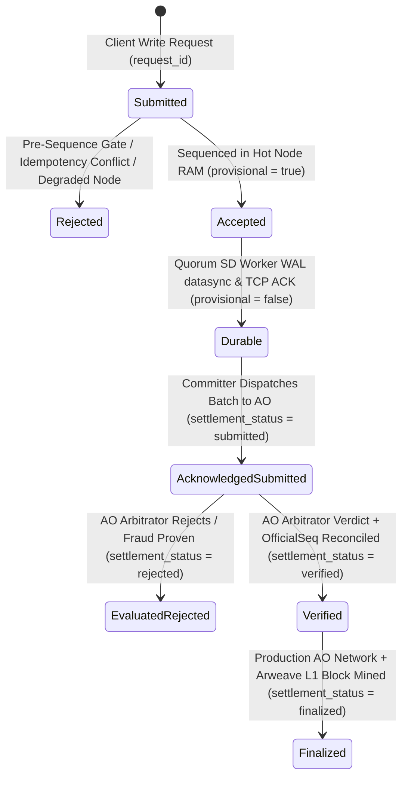

# HyDB Protocol, Components & Failure Model Specification

> **Normative Specification:** System Guarantees, Quorum & Durability Boundaries, Crash Recovery Semantics, Idempotency Contracts, AO Settlement Lifecycle, and Verification Traceability.
> **Audit Baseline Commit:** `83c76f9` (Branch: `beta`)
> **Protocol Version:** `hydb.core@1.0` / Canonical TLV Wire Format `hydb.spec/1` (`0x48 0x59`, version `0x01`)

---

## 1. Baseline & Component Inventory

This specification is anchored from baseline commit **`83c76f9`** on branch `beta` and tracks the hardened release gates across Phases `00` through `07`. Every guarantee in this document is classified using three strict verification levels:

- **`Implemented`**: Enforced in production code paths (Erlang BEAM, Rust WASM, Lua AO, or ESM SDK).
- **`Tested`**: Verified by automated deterministic unit, integration, or multi-process fault-injection tests executed in CI (`.github/workflows/ci.yml`).
- **`Cross-Language Golden-Vector Tested`**: Deterministically invariant across all implementations (JS, Erlang, Rust WASM, Lua) verified against shared canonical golden vectors (`spec/golden_vectors.json`) regenerated and checked in CI (`npm run verify:vectors`).

### 1.1 Core Stack Components

| Component | Repository Path | Runtime / Technology | Role & Responsibilities |
| :--- | :--- | :--- | :--- |
| **Hot Node Sequencer** | `hymessage/` | Gleam + Erlang BEAM (`~hymessage@1.0`) | Primary sequencer, HTTP API (`:8734`), Pre-Sequence Gate, Idempotency Ledger, Fixed-Quorum Coordinator, Framed TCP Replication Server (`:8736`). |
| **SD Worker Pool** | `sd/` | Gleam + Erlang BEAM (`~sd@1.0`, `~scheduler@1.0`) | Shared Data Pool replica, HTTP API (`:8735`), Framed TCP Replication Client (`:8736`), Disk WAL Engine (`sd/wal.log`) with `file:datasync`, fail-closed recovery validator, ETS state mirror. |
| **HyDB Silicon Engine** | `hydb/` | Rust `no_std` (WASM32 `hydb.wasm`) | $O(1)$ dense slot table (1024 slots), tombstone-preserving linear probing, in-WASM boundary validation (`min_value`, `max_value`, `max_records`), rolling 64-bit Merkle-XOR `StateRoot`. |
| **AO Arbitrator & Committer** | `ao_process/` | Lua (`arbitrator.lua`) + ESM (`committer.mjs`, `committer_daemon.mjs`) | Independent hash-chain & state-commitment verifier, equivocation detector, Constitutional Guardrail C, durable checkpoint cursor (`committer_cursor.json`), evidence-based settlement status classifier. |
| **Universal Client SDK** | `sdk/` | JavaScript / ESM (`hydb_sdk.mjs`) | Declarative contract builder (`defineContract`), WASM sandbox preflight (`preflightDryRun`), Arweave manifest publisher, namespace client. |
| **Normative Specification** | `spec/` | JavaScript / ESM (`hydb_contract_spec.mjs`, `golden_vectors.json`) | Normative Canonical TLV event encoding, FNV-1a / SHA-256 hash chain definitions, 64-bit Merkle-XOR & 256-bit state commitment algorithms, and cross-language golden vectors. |

---

## 2. Write & Settlement Status Lifecycle

HyDB separates **local sequencing**, **replica WAL durability**, **AO cryptographic verification**, and **Arweave L1 finality** into distinct, non-conflated statuses.

### 2.1 Write Status Semantics (`Hot Node` $\leftrightarrow$ `SD Worker`)

| `write_status` | HTTP Code | `provisional` | Formal Condition | Durability & Visibility Boundary | Verification Status & Suite |
| :--- | :---: | :---: | :--- | :--- | :--- |
| **`accepted`** | `202` / `504` | `true` | Request passed Pre-Sequence Gate and received a monotonic `seq`, but configured quorum ACK was not yet met. Recorded in `hot_wal.log` after quorum evaluation with `replicated: false` and `commit_status: "provisional"`. | **Provisional (`commit_status: "provisional"`, `replicated: false`).** Never reported as durable, and **never promoted to `durable` during Hot WAL startup replay** unless quorum ACK was recorded. Normal reads (`GET /get`) hide provisional mutations by default unless `include_provisional=true` is explicitly requested. Promoted to `durable` on disk (`promote_hot_wal_event_durable`) once SD quorum ACKs arrive. | **Implemented & Tested** (`tests/test_tahap04_idempotency.mjs`, `tests/fault_injection_chaos.mjs`) |
| **`durable`** | `200` | `false` | Event encoded in Canonical TLV, transmitted over authenticated TCP (`:8736`), appended to `sd/wal.log`, flushed via `file:datasync`, and acknowledged by a majority quorum ($Q = \lfloor N/2 \rfloor + 1$) of configured cluster members (deduplicated by `NodeId`). | Survives fail-stop OS process crashes (`SIGKILL`) of the Hot Node or individual SD Workers, **provided at least one intact quorum WAL replica remains accessible**. | **Implemented, Tested & Cross-Language Golden-Vector Tested** (`tests/test_tahap03_quorum_hash.mjs`, `tests/fault_injection_chaos.mjs`) |
| **`unknown`** | `404` / Timeout | `null` | Client experienced an HTTP/network timeout before receiving a response, or queried `/request_status` for an unseen `request_id`. | **Timeout does NOT imply write failure.** The mutation may be `accepted`, `durable`, or never reached the sequencer. Client must query `GET /request_status?request_id=<id>` or retry with the identical `request_id`. | **Implemented & Tested** (`tests/test_tahap04_idempotency.mjs`, `tests/fault_injection_chaos.mjs`) |

### 2.2 AO Settlement Status Semantics (`ao_process/committer.mjs`)

A batch submission to AO is **never** marked `confirmed: true` merely because `message()` or an HTTP gateway post returned a message/transaction ID.

| `settlement_status` | `verified` | `confirmed` | `finalized` | Required Cryptographic / Operational Evidence | Verification Status & Suite |
| :--- | :---: | :---: | :---: | :--- | :--- |
| **`submitted`** | `false` | `false` | `false` | `message()` or gateway TX post returned a `msg_id` / `tx_id`, but Arbitrator evaluation result is pending or unverified (`evaluation_status: "pending"`). | **Implemented & Tested** (`tests/test_tahap06_ao_committer.mjs`) |
| **`rejected`** | `false` | `false` | `false` | Arbitrator evaluated the batch and returned a rejection verdict (`REJECTED_*`, `EQUIVOCATION_PROVEN`, `FENCE_AND_DROP_ZOMBIE_HOT`). | **Implemented & Tested** (`tests/test_tahap06_ao_committer.mjs`, `tests/test_tahap6_ao_arbitrator.mjs`) |
| **`verified`** | `true` | `true` | `false` | Arbitrator evaluated the batch (`COMMITTED` or `DUPLICATE_BATCH_IDEMPOTENT`) with non-empty `OfficialSeq`, `OfficialHash`, and `OfficialStateRoot` matching the batch (missing fields are rejected with `MISSING_ARBITRATOR_PROOF_FIELDS`). On `arlocal_local` (`127.0.0.1:1984`), settlement stops at `verified` (`finalized: false`). | **Implemented & Tested** (`tests/test_tahap06_ao_committer.mjs`) |
| **`finalized`** | `true` | `true` | `true` | All requirements of `verified` are met on a target **`ao_network`** deployment **plus** gateway-verified Arweave L1 block finality proof (`/tx/<id>/status` with `block_indep_hash`, `block_height > 0`, `number_of_confirmations >= minConfirmations`, and `/tx/<id>` bound to the submitted AO message/bundle ID, target AO Process ID `target`/`Recipient`, and full commitment tags `Action: CommitCheckpoint`, `Batch-Id`, `From-Seq`, `To-Seq`, `State-Root`, `Hash`, with optional multi-gateway consensus `l1Gateways`). | **Implemented & Tested** (`tests/test_tahap06_ao_committer.mjs`) |
| **`unknown`** | `false` | `false` | `false` | Transport failure or timeout prevented evidence collection; daemon preserves `lastCommittedSeq` without advancing cursor and retries idempotently. | **Implemented & Tested** (`tests/test_tahap06_ao_committer.mjs`) |

---

## 3. Protocol Guarantees, Assumptions & Failure Model

### 3.1 Canonical Event Encoding & Hash Protocol (`Phase 03`)
* **Normative Definition**: Every sequenced mutation (`PUT` op `1`, `DEL` op `2`) is serialized into the canonical binary TLV record format (`0x48 0x59`, version `1`, `op`, `seq:64/big`, `epoch:32/big`, `key_len:16/big`, `key`, `val_len:32/big`, `val`) before computing the 64-bit FNV-1a chain link (`compute_chain_hash(PrevHash, TlvBytes)`) and 64-bit Merkle-XOR state root (`canonical_hash_64(Key, Val, Ver)`).
* **Cross-Language Invariance**: JavaScript (`spec/hydb_contract_spec.mjs`), Erlang (`hymessage_runtime.erl`, `sd_runtime.erl`, `hydb_spec.erl`), Rust WASM (`hydb/src/lib.rs`), and Lua (`ao_process/arbitrator.lua`) execute the identical byte-level algorithm verified against `spec/golden_vectors.json`.
* **Status**: **Cross-Language Golden-Vector Tested & Tested** (`tests/contract_conformance.mjs`, `tests/test_tahap03_quorum_hash.mjs`).

### 3.2 Fixed Cluster Membership, Node Identity & Non-Shrinking Quorum (`Phase 03`)
* **Quorum Assumption, Size Consistency & Fail-Closed Persistence**: Cluster membership size $N$ and allowed member IDs are determined by explicit configuration (`HYDB_CLUSTER_MEMBERS` and `HYDB_CLUSTER_SIZE`, persisted across restarts in `cluster_membership.json`), never by counting currently connected TCP subscriber sockets. Whenever `HYDB_CLUSTER_MEMBERS` is non-empty, `HYDB_CLUSTER_SIZE` must equal the number of unique configured members (`ERR_CLUSTER_SIZE_MISMATCH` on mismatch, and `get_configured_cluster_size()` enforces `max(ClusterSize, length(Members))`). Dynamic membership changes (`set_cluster_membership`) persist and `file:datasync` to disk **before** updating ETS, failing closed with `HTTP 503 ERR_MEMBERSHIP_PERSIST_FAILED` if disk I/O fails. During the TCP handshake (`verify_su_handshake/2`), `NodeId` must be a member of the configured cluster (`ERR_NODE_NOT_IN_CLUSTER_MEMBERS` if unknown), duplicate sockets for the same `NodeId` are evicted, and `count_acked_subscribers/1` deduplicates ACKs by `NodeId`.
* **Partition Invariant**: The required durability quorum majority is fixed at:
  $$Q = \lfloor N / 2 \rfloor + 1$$
  If SD Worker connections drop below $Q$, the Hot Node **never** lowers $Q$. Requests with `require_durable=true` fail-closed with `HTTP 504 ERR_DURABILITY_TIMEOUT` until at least $Q$ distinct configured cluster members acknowledge WAL persistence.
* **Status**: **Implemented & Tested** (`tests/test_tahap03_quorum_hash.mjs`, `tests/fault_injection_chaos.mjs` Scenario 2).

### 3.3 Request Idempotency, Parameter Matching & Write-Ahead Ordering (`Phase 04`)
* **Contract**: Clients attach a unique `request_id` (or `idempotency_key` / `x-request-id` header) to `/put`, `/del`, and `/schema` requests. In production mode (`is_test_profile() == false`), `request_id` is mandatory (`HTTP 400 ERR_MISSING_REQUEST_ID`).
* **Write-Ahead Hot WAL Ordering & Immediate RAM Idempotency**:
  - Hot Node enforces strict write-ahead ordering: operations append an initial `provisional` WAL entry to `hot_wal.log` *before* attempting network quorum replication to SD workers.
  - Idempotency is recorded immediately in `?IDEMPOTENCY_TABLE` in RAM before SD broadcast. If the Hot WAL disk encounters an I/O failure, the write fails closed (`HTTP 503 ERR_HOT_WAL_IO_ERROR`) without mutating state or broadcasting to SD. If SD replication completes or times out, the RAM idempotency cache ensures retries with the same `request_id` are served without duplicate mutation, even if the Hot Node transitions to degraded disk mode.
  - Upon receiving quorum ACKs from SD replicas, the Hot WAL entry is atomically promoted to `durable` via `promote_hot_wal_event_durable/1` and the idempotency entry is updated to `commit_status: "durable"`.
* **Retry Guarantee, Quorum Parameter Check & Bounded Retention**: Retrying an identical request (`op`, `ns`, `key`, `val`, `quorum`, `request_id`) within the retention window returns the original sequence number and state root (`idempotent_replay: true`) without allocating a new `seq`, mutating state twice, or appending duplicate WAL frames. Reusing the same `request_id` with a different payload, operation, or `quorum` mode is rejected with `HTTP 409 ERR_IDEMPOTENCY_KEY_CONFLICT`. `request_id` and its `commit_status` (`durable` vs `provisional`) are persisted in `hot_wal.log` and reconstructed into `?IDEMPOTENCY_TABLE` during `hymessage_runtime:init([])` startup replay. Deduplication is retained for up to `HYDB_IDEMPOTENCY_MAX_ENTRIES` (default `10,000` entries; oldest entries are evicted FIFO once capacity is exceeded).
* **Status**: **Implemented & Tested** (`tests/test_tahap04_idempotency.mjs`, `tests/fault_injection_chaos.mjs` Scenario 5).

### 3.4 Fail-Closed WAL Recovery, Truncation/Newline Repair & Disk I/O (`Phase 02`)
* **Cold-Boot Verification (SD & Hot WAL)**: On startup or `/recover`, both `sd_runtime` (`sd/wal.log`) and `hymessage_runtime` (`HYDB_HOT_WAL_PATH` with automatic fallback to `HYDB_RECONCILE_WAL_PATH` / `HYDB_WAL_PATH` when local Hot WAL is missing, empty, or stale) scan the WAL from byte offset `0`, verifying monotonic sequence numbers (`Seq == PrevSeq + 1`), unbroken `prev_hash` linkage, canonical event hash match, mandatory `state_root` presence and recomputation (`missing_state_root` if absent), and non-decreasing epoch numbers.
* **Compose Multi-Volume SD Fallback**: In multi-container Docker Compose deployments, each SD worker replica volume (`sd_node_1_data`, `sd_node_2_data`, `sd_node_3_data`) is mounted read-only to `hot-node`. `HYDB_RECONCILE_WAL_PATH` accepts a comma-separated list of candidate SD WAL paths (`/app/data/node_sd_1/wal.log,/app/data/node_sd_2/wal.log,...`), enabling Hot Node to select and reconstruct state from the SD replica with the highest validated sequence if the Hot volume is destroyed or lost.
* **Independent State Root Recomputation**: Recovery rebuilds the in-memory state from validated events and dynamically recomputes `state_root` via `canonical_hash_64/3` across all active non-tombstone records. It never blindly trusts a stored root field in the WAL.
* **Crash Truncation / Missing Trailing Newline Repair vs. Mid-File Corruption & Disk I/O Failures**:
  - *Physical EOF Crash Truncation & Missing Newline Repair*: An incomplete trailing line at the very end of `wal.log` / `hot_wal.log` caused by an OS crash during write, or a valid final JSON line missing its trailing `\n` byte, is physically repaired on disk (`repair_truncated_wal_file/2` / `repair_hot_wal_file/2` with trailing `\n` and `file:datasync`) before opening the WAL in append mode, ensuring subsequent appends never concatenate onto the last JSON line or attach to a corrupted tail.
  - *Mid-File Corruption & Disk Write/Datasync Failure*: Any mid-file corruption, hash/root mismatch, sequence gap, or runtime `file:write` / `file:datasync` failure transitions the node into **`node_health: "degraded"` (`wal_corrupted: true` / `hot_wal_corrupted: true`)** and returns `ok: false` (`HTTP 503 ERR_WAL_CORRUPTED_DEGRADED` / `ERR_HOT_WAL_CORRUPTED` / `ERR_HOT_WAL_IO_ERROR`). A degraded node refuses all new writes until operator intervention.
* **Status**: **Implemented & Tested** (`tests/test_tahap02_wal_recovery.mjs`, `tests/fault_injection_chaos.mjs` Scenarios 3 & 4).

### 3.5 Control Endpoint Authentication & Fail-Closed Production Profile (`Phase 01`)
* **Fail-Closed Default Profile & Mandatory Secrets**: If `HYDB_PROFILE`, `HYDB_ENV`, and `NODE_ENV` are unset, both Hot Node and SD Worker default to **production** (`is_test_profile() == false`). Startup (`init([])`) fails immediately if `HYDB_CLUSTER_SECRET` or `HYDB_ADMIN_TOKEN` is missing, shorter than 16 bytes, or identical to each other in production. Wallet file fallback is forbidden in production.
* **Admin Control Plane Protection**: Administrative endpoints (`/reset`, `/fence_epoch`, `/simulate_restart`, `/promote_epoch`, `/set_cluster_membership`) require explicit constant-time authentication (`crypto:hash_equals`) via `x-admin-token`, `Authorization: Bearer`, or `admin_token` matching `HYDB_ADMIN_TOKEN`. Destructive test endpoints (`/reset` and `/simulate_restart`) are strictly disabled (`HTTP 403 ERR_TEST_ENDPOINT_DISABLED`) outside `test` profile.
* **Status**: **Implemented & Tested** (`tests/test_tahap01_security.mjs`).

### 3.6 Durable Epoch Persistence & Zombie Hot Node Fencing (`Phase 01 & 05`)
* **Split-Brain Defense**: When an operator or AO Arbitrator promotes the cluster to `Epoch E + 1`, both Hot Node (`hot_epoch.meta`) and SD Worker (`epoch.meta`) persist the fenced epoch to disk with `file:datasync` and reload it on `init([])` startup. Any write or replication frame carrying `Epoch < CurrentEpoch` is rejected (`HTTP 409 FENCED_STALE_EPOCH` on Hot Node; dropped on SD Worker; `FENCE_AND_DROP_ZOMBIE_HOT` on AO Arbitrator) without mutating state or WAL.
* **Status**: **Implemented & Tested** (`tests/fault_injection_chaos.mjs` Scenario 6, `tests/test_maximal_poc.mjs`).

### 3.7 Durable AO Committer Cursor & Divergence Detection (`Phase 06`)
* **Cursor Persistence (`fsyncSync`) & Full State Reconciliation**: `ao_process/committer_daemon.mjs` persists `last_committed_seq`, `last_committed_hash`, and `last_state_root` atomically to disk (`committer_cursor.json`) using `fsyncSync` before `renameSync`, and reconciles with the AO Arbitrator (`GetOfficialState`) on startup.
  - If the local disk cursor sequence is ahead of AO `OfficialSeq`, the daemon reports `mismatch_detected: true` (`reconciliation_status: "diverged_local_ahead_of_ao"`) and halts fail-closed (`ERR_CURSOR_AHEAD_OF_AO_OFFICIAL_SEQ`).
  - If sequence numbers match (`diskCursor.last_committed_seq === aoState.official_seq`) but `official_hash` or `official_state_root` differ, the daemon flags cryptographic state divergence (`reconciliation_status: "diverged_state_mismatch"`, `error_code: "ERR_CURSOR_AO_STATE_MISMATCH"`) and aborts further cycle execution fail-closed.
* **Native Packaging, Single Owner & Mutual Exclusion**:
  - The committer daemon is native to the SD node distribution (`docker/Dockerfile.sd-node`, `scripts/run-sd-node-foreground.sh`, `scripts/start-sd-node.sh`, `scripts/start-committer-worker.sh`, and `ao_process/committer_daemon.mjs`). Any SD replica can be designated as the active committer owner via `HYDB_COMMITTER_ENABLED=true` (all other replicas explicitly disable committer execution via `false`). The legacy separate `committer-daemon` service has been eliminated 100%.
  - Startup enforces fail-fast: if `HYDB_COMMITTER_ENABLED=true` and Node.js or locked dependencies are missing, the node immediately halts with exit code 1.
  - Mutual exclusion is enforced across processes via an atomic filesystem lock (`committer.lock` using `openSync('wx')` and active OS PID detection) backed by durable storage (`committer_data:/app/data/committer`). Any competing worker attempting to access the same cursor directory is rejected with `ERR_COMMITTER_LOCK_HELD`.
* **Supervisor Crash-Loop Defense & Exit Code 78 (`EX_CONFIG`)**:
  - When encountering fatal fail-closed conditions (state divergence, unanchored production process, or active lock contention), the committer exits with code `78` (`FATAL_FAIL_CLOSED_EXIT_CODE`).
  - Active container supervision (`scripts/run-sd-node-foreground.sh`) monitors the committer worker directly without using `tail -f /dev/null`. Upon detecting exit code 78, the container immediately terminates fail-closed with code 78, preventing infinite crash-restart loops while preserving transient crash recovery (exponential backoff up to 5 retries on transient network/gateway blips).
* **Heartbeat & Health Status Reporting**:
  - The daemon maintains a heartbeat health file (`committer_status.json`) in the cursor directory, exposing runtime status (`idle`, `running`, `halted`, `failed_closed`, `retry_pending`, `stopped`), PID, sequence progress, and ISO 8601 timestamps.
* **Production Gate on AO Process Creation**:
  - Silent auto-creation of AO processes is strictly prohibited in production mode (`HYDB_PROFILE=production` or `HYDB_ENV=prod`), requiring an explicit `AO_PROCESS_ID` (`ERR_AO_PROCESS_ID_REQUIRED`).
* **Batch Idempotency & Equivocation Detection**: Retrying an already-committed batch `[from_seq, to_seq]` with an identical final hash returns `DUPLICATE_BATCH_IDEMPOTENT` without creating duplicate entries in `Checkpoints`. Submitting an overlapping batch whose hash conflicts with `EventHistory[to_seq].hash` triggers cryptographic fraud rejection (`EQUIVOCATION_PROVEN`).
* **L1 Finality Trust Boundaries & Multi-Gateway Consensus**:
  - `verifyArweaveL1Finality` validates block inclusion (`block_indep_hash`, `block_height`, confirmations) and full tag binding (`Batch-Id`, `Recipient`, sequence range, state root, event hash).
  - *Trust Boundary*: A single gateway configuration (`gateways.length === 1`) operates under `trust_boundary: "single_gateway_trusted_provider"` (trusting the provider not to spoof finality blocks). Multi-gateway configurations (`l1Gateways` with $\ge 2$ URLs) enforce cross-gateway agreement on `block_indep_hash` and `block_height` (`trust_boundary: "multi_gateway_consensus"`).
  - *Fail-Closed Multi-Gateway Enforcement*: When `requireMultiGateway: true` (or `REQUIRE_MULTI_GATEWAY=true`) is configured, single-gateway verification is rejected fail-closed with `MULTI_GATEWAY_CONSENSUS_REQUIRED`.
* **Status**: **Implemented & Tested** (`tests/test_tahap06_ao_committer.mjs`).

### 3.8 Scope Boundaries & Explicit Non-Claims
To maintain engineering rigor, HyDB explicitly states the boundaries where guarantees depend on external infrastructure:
1. **No Unqualified "Zero Data Loss"**:
   - mutations with `write_status: "accepted"` (`provisional: true`) reside only in Hot Node RAM until TCP catch-up replication finishes and **can be lost** if the Hot Node process is killed (`SIGKILL`) before replication.
   - mutations with `write_status: "durable"` survive fail-stop crashes of the Hot Node or up to $N - Q$ SD replicas, **conditional on at least one intact WAL file (`sd/wal.log`) surviving on disk without media destruction**.
2. **No Unqualified "Irreversible Finality" on Local Simulation**:
   - Local tests running against ArLocal (`127.0.0.1:1984`) and in-memory WASM `@permaweb/ao-loader` verify deterministic state-machine execution (`settlement_status: "verified"`, `finalized: false`), **not** decentralized censorship-resistant finality. True L1 finality (`settlement_status: "finalized"`, `finalized: true`) requires deployment to the production AO network and confirmed Arweave L1 block settlement.
3. **Gateway Trust Assumption Boundary**:
   - When configured with a single Arweave gateway URL, L1 transaction confirmation proof relies on that gateway's status report (`single_gateway_trusted_provider`). For trust-minimized production settlement, deployers must configure multiple independent gateways via `L1_GATEWAYS` and set `REQUIRE_MULTI_GATEWAY=true` (`multi_gateway_consensus`).

---

## 4. Guarantee & Verification Traceability Matrix

| Phase | Roadmap Workstream | Guarantee Classification | Primary Implementation Files | Automated Verification Suite |
| :---: | :--- | :---: | :--- | :--- |
| **00** | **Reproducible Baseline & CI** | `Implemented` & `Tested` | `.github/workflows/ci.yml`, `package.json` | GitHub Actions CI (`npm ci` + all suites) |
| **01** | **Control Endpoint & Secret Security** | `Implemented` & `Tested` | `sd/src/sd_runtime.erl`, `hymessage/src/hymessage_runtime.erl` | `npm run test:security` (`tests/test_tahap01_security.mjs`) |
| **02** | **Fail-Closed WAL Recovery & Integrity** | `Implemented` & `Tested` | `sd/src/sd_runtime.erl` | `npm run test:recovery` (`tests/test_tahap02_wal_recovery.mjs`) |
| **03** | **Canonical Hash & Fixed Quorum** | `Cross-Language Golden-Vector Tested` & `Tested` | `spec/hydb_contract_spec.mjs`, `spec/golden_vectors.json`, `hymessage/src/hymessage_runtime.erl`, `sd/src/sd_runtime.erl`, `hydb/src/lib.rs`, `ao_process/arbitrator.lua` | `npm run test:conformance` (`tests/contract_conformance.mjs`) & `npm run test:quorum` (`tests/test_tahap03_quorum_hash.mjs`) |
| **04** | **Write Idempotency & Provisional Status** | `Implemented` & `Tested` | `hymessage/src/hymessage_runtime.erl` | `npm run test:idempotency` (`tests/test_tahap04_idempotency.mjs`) |
| **05** | **Multi-Process Chaos & Fault Injection** | `Implemented` & `Tested` | `tests/chaos_node_daemon.escript`, `tests/fault_injection_chaos.mjs` | `npm run test:chaos` (`tests/fault_injection_chaos.mjs`) |
| **06** | **Evidence-Based AO Committer & Cursor** | `Implemented` & `Tested` | `ao_process/committer.mjs`, `ao_process/committer_daemon.mjs`, `ao_process/arbitrator.lua` | `npm run test:committer` (`tests/test_tahap06_ao_committer.mjs`) |
| **07** | **Documentation & Release Gate Audit** | `Implemented` & `Tested` | `docs/PROTOCOL_AND_FAILURE_MODEL.md`, `README.md`, `tests/test_tahap07_release_gate.mjs` | `npm run test:release-gate` (`tests/test_tahap07_release_gate.mjs`) |
